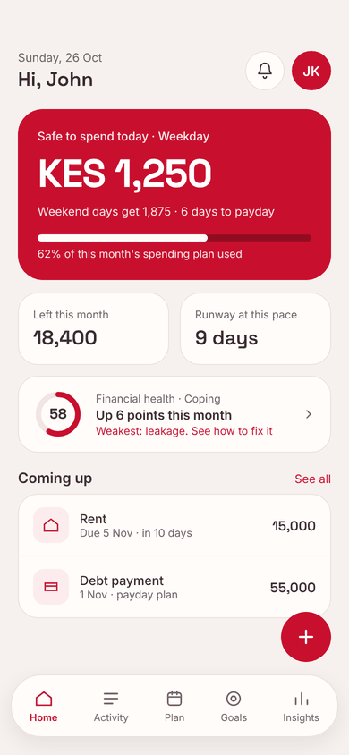
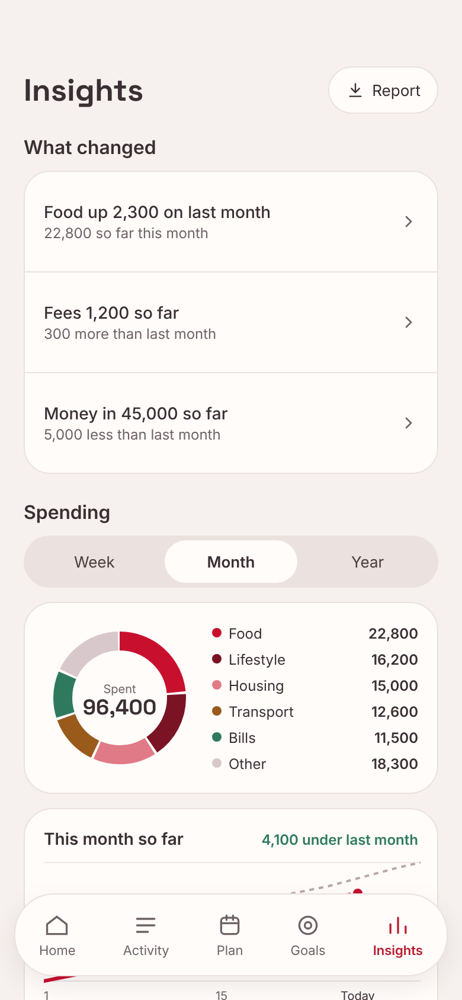
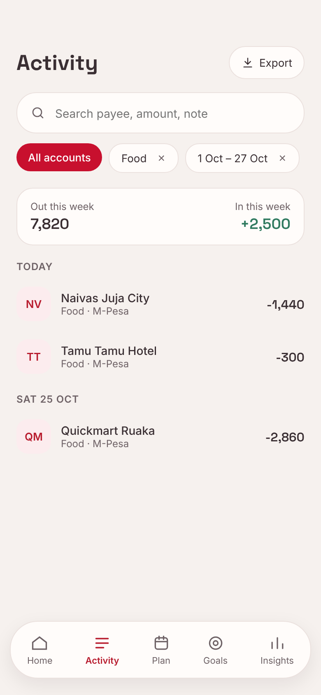
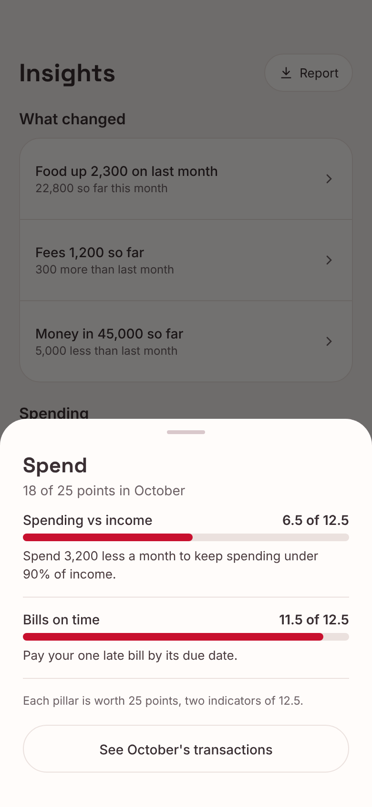
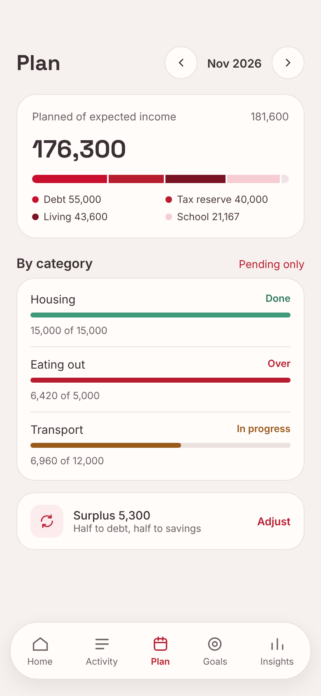
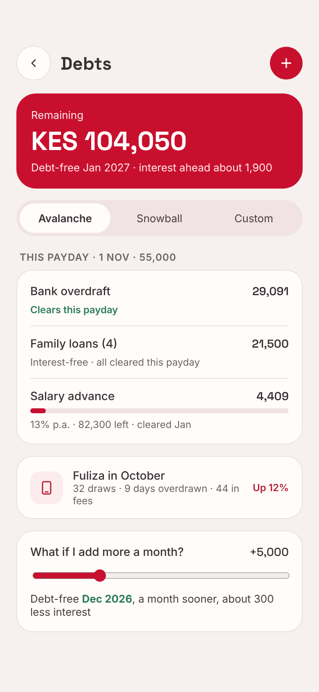

# Pesa Clarity app

[](https://github.com/pesaclarity/pesaclarity-app/stargazers)
[](LICENSE)
[](https://github.com/pesaclarity/pesaclarity-app/releases/tag/test-build)

Pesa Clarity is a free, ad-free, open-source Android and iPhone app that turns M-Pesa and bank SMS into a clear daily plan: what you can safely spend today, which bills are due, where money leaks, and when you will be debt-free. All analysis runs on the phone. This repository holds the Flutter app.

**Status:** pre-release, not yet in any store. Working: onboarding, SMS capture on Android and Shortcuts capture on iPhone, statement import, the review inbox with the message reader, Home (safe to spend, forecast, Financial Health Index), Activity, Plan, Goals and debts, Insights, subscriptions, base currency, encrypted backups, sign-in and app lock. The server is not deployed yet, so sign-in and the vault are off in builds without a server address.

**Download:** the newest test build is on [Releases](https://github.com/pesaclarity/pesaclarity-app/releases): [Android](https://github.com/pesaclarity/pesaclarity-app/releases/download/test-build/pesaclarity-play.apk) (`play`) or the [F-Droid build](https://github.com/pesaclarity/pesaclarity-app/releases/download/test-build/pesaclarity-foss.apk) (`foss`, no Google services). The privacy policy and terms ship in `assets/policy/` and match the website.

<p align="center">
  
</p>

| Home | Insights | One category |
| :---: | :---: | :---: |
|  |  |  |
| **Health score** | **Plan** | **Debts** |
|  |  |  |

Screens from the app's design, with made-up example data.

## Get involved

Pesa Clarity is built in the open, for people who live on M-Pesa and bank SMS.

- **Star this repo** so more people find a private money app that runs on their phone.
- **Add your bank or Sacco.** Each one is a small YAML pack with synthetic sample messages in [ujumbe-parsers](https://github.com/pesaclarity/ujumbe-parsers); no Flutter needed.
- **Pick a first issue:** [good first issues](https://github.com/search?q=org%3Apesaclarity+label%3A%22good+first+issue%22+is%3Aopen&type=issues) and [help wanted](https://github.com/search?q=org%3Apesaclarity+label%3A%22help+wanted%22+is%3Aopen&type=issues) across the project.
- **Report what reads wrongly** with a [new issue](https://github.com/pesaclarity/pesaclarity-app/issues/new/choose); leave out real names, numbers and messages.
- **Read [CONTRIBUTING.md](CONTRIBUTING.md)** before your first pull request.

The product spec, brand guide and design tokens live in [pesaclarity/docs](https://github.com/pesaclarity/docs).

## Quick start

You need Flutter stable (3.47 or later) and, for device builds, the Android SDK with JDK 17, or Xcode on a Mac for iPhone.

```sh
flutter pub get
dart run build_runner build --delete-conflicting-outputs   # Drift code generation
flutter run --flavor foss                                  # or --flavor play
```

Build a release APK:

```sh
flutter build apk --release --flavor foss --obfuscate --split-debug-info=build/symbols
```

Release builds use the debug key unless `android/key.properties` exists (see `android/key.properties.example`). Keystores never go in the repo.

For iPhone, see [iPhone](#iphone).

## Build flavours

| Flavour | For | Rule |
| --- | --- | --- |
| `play` | Google Play | May use Google services (Sign-In, Play Integrity) |
| `foss` | F-Droid | No Google services or other proprietary dependencies |
| `appstore` | App Store (iPhone) | No Google services. iPhone builds take no `--flavor`; they resolve to this one |

Dart code reads the flavour through `appFlavorProvider` (`lib/src/config/flavor.dart`). Android builds without a known flavour, including tests, behave as `foss`.

### Server

Accounts (sign-in, devices, delete account) talk to the Pesa Clarity server. People sign in with a 6-digit code sent to their email. `play` builds also offer Google sign-in through Android's Credential Manager when built with `--dart-define=PESACLARITY_GOOGLE_SERVER_CLIENT_ID=<web client id>` (the same id the server lists in `NGOME_GOOGLE_CLIENT_IDS`). Its Kotlin lives in `android/app/src/play/` and its libraries are `playImplementation` dependencies, so `foss` builds carry no Google code and sign in by email only. Set the server address at build time:

```sh
flutter run --flavor foss --dart-define=PESACLARITY_API_URL=https://api.example.org
```

Only `https` is accepted, apart from `http://10.0.2.2`, `localhost` and `127.0.0.1` for local development. Without it, the app works fully without an account and sign-in explains that accounts come in a later update.

## Project layout

```text
lib/
  main.dart
  src/
    app.dart                 root widget
    config/                  build flavour (play, foss, appstore) and server settings
    core/backup/             .pcbackup format: AES-256-GCM, Argon2id, recovery key (pure Dart)
    core/network/            pinned HttpClient factory (trusted roots per host, from build config)
    core/integrity/          Play Integrity stub, App Attest (iPhone), foss no-op, request header hook
    core/money/              Money (integer minor units), base currency and formatting
    domain/                  pure-Dart money rules, no Flutter or database imports
      time/                  calendar dates and months in the person's timezone
      ledger/                own transfers, Fuliza fees, noise collapse, honest totals
      budget/                safe to spend today, weekday and weekend limits
      plan/                  monthly plan, arrears, category status, surplus split, snapshots
      payees/                identifier normalising and matching, payee and override precedence
      categories/            default category set (keys shared with the categoriser)
      categoriser/           categoriser input, rules fallback, model manifest
      reader/                message reader input, decoding, rules reader, saved layouts
      tags/                  tag names, filtering and totals by tag
      debts/                 payoff strategies, payday split, family loans, Fuliza tracker, repayment matching
      health/                Financial Health Index: eight indicators, bands, best action
      forecast/              cash-flow forecast to month end: zero date, charges that may fail
      subscriptions/         recurring charges and their totals
    data/
      database/              Drift tables, SQLCipher connection, key store
      repositories/          thin repository interfaces and Drift implementations
    features/                one folder per area: onboarding, home, activity, plan, goals,
                             debts, lending, insights, profile, backup, privacy, accounts,
                             auth, security, reminders, export, payees, categoriser,
                             currency, timezone, subscriptions, statements, review, sms
    routing/                 go_router: five-tab shell; Profile under Home, Debts under Goals
    shared/adaptive/         shared dialog, picker, choice and grouped-row helpers
    shared/widgets/
    theme/                   brand tokens, light and dark themes, iOS and Android typography
test/                        unit, widget and database tests
.maestro/                    Maestro UI flows (YAML), one per journey
tool/                        UI flows, F-Droid prep, release build, Swift type-check
android/                     Android project (applicationId com.pesaclarity.app)
ios/                         iPhone project (bundle id com.pesaclarity.app)
assets/fonts/                Space Grotesk and Inter, with their OFL licences
```

State is managed with Riverpod and navigation with go_router.

## Security baseline

From the spec's "Mobile security" section:

- Database encrypted with SQLCipher. The 256-bit key is generated on the phone and kept in Android Keystore-backed secure storage. The app refuses to open the database if SQLCipher is not loaded.
- `FLAG_SECURE` on the main activity blocks screenshots, recording and app-switcher previews in release builds. Debuggable builds skip it so CI can capture UI screenshots; release builds are never debuggable.
- Android auto-backup and device transfer are off (`allowBackup="false"` plus extraction rules that exclude everything).
- Permissions: `READ_SMS`, `RECEIVE_SMS`, `POST_NOTIFICATIONS`, `RECEIVE_BOOT_COMPLETED` (to restore reminders after a restart) and `INTERNET` (sign-in, backups and the privacy policy) only. `test/android/manifest_permissions_test.dart` fails if the list changes. Cleartext traffic is off.
- Cleartext traffic is refused. Every `HttpClient` comes from `HttpClientFactory` (`lib/src/core/network`). Our servers are pinned to their certificate authorities, not their keys, because the hosting providers renew certificates with new keys every few months: connections to the hosts in `PESACLARITY_PINNED_HOSTS` trust only the roots in `PESACLARITY_TRUSTED_ROOTS` (two or more), and a misconfiguration refuses every connection. Third-party services (Google Drive) use the platform's authorities. A test fails if code creates an `HttpClient` any other way. The real values are set once the server is deployed.
- Device integrity: `IntegrityAttestor` (`lib/src/core/integrity`) supplies a token header for backup and federated-learning requests; the `play` stub returns "unavailable" until the Play project exists, and `foss` never attests. A light root and tamper check (`DeviceIntegrityChannel.kt`) shows a one-time notice in Profile and never blocks use.
- Dependencies are scanned with OSV-Scanner in CI (`.github/workflows/dependency-scan.yml`) and updated by Dependabot.
- R8 minification and resource shrinking on release builds; Dart obfuscation via `--obfuscate`.

- App lock: with a PIN (and fingerprint or Face ID) set, the database key is released only after unlocking (`UnlockedDatabaseKeyStore`).

Not done yet: StrongBox-backed keys, the pinned hosts and roots for the deployed server (set at build time once it is live), and real Play Integrity tokens (the `play` attestor is a stub until the Play project exists; iPhone uses App Attest).

Releases: see [RELEASING.md](RELEASING.md), [docs/reproducible-builds.md](docs/reproducible-builds.md) and [docs/performance-budget.md](docs/performance-budget.md). F-Droid store text lives in `fastlane/metadata/android/en-US`.

## SQLCipher

The database uses `package:sqlite3` 3.x with its SQLCipher build, chosen in `pubspec.yaml` under `hooks.user_defines.sqlite3.source`. This replaces `sqlcipher_flutter_libs`, which reached end of life when `sqlite3` 3.x began bundling SQLCipher itself. The build hook downloads checksum-verified SQLCipher binaries from the `sqlite3.dart` GitHub releases; F-Droid may require building SQLCipher from source instead (the hook supports `source: source`).

## Fonts

Space Grotesk (numbers and titles, tabular figures) and Inter (body text) are bundled in `assets/fonts/` as variable fonts. The app never fetches fonts over the network. Both are under the SIL Open Font License 1.1; the licence texts sit next to the font files. To update them, take `ofl/spacegrotesk/SpaceGrotesk[wght].ttf` and `ofl/inter/Inter[opsz,wght].ttf` from [google/fonts](https://github.com/google/fonts).

## Parser package

SMS parsing comes from the `ujumbe` Dart package in [pesaclarity/ujumbe-parsers](https://github.com/pesaclarity/ujumbe-parsers), a git dependency pinned to a commit on `main` until `v0.1.0` is tagged. The institutions in My accounts are its bundled parser packs: each pack gives the id, name and sender IDs.

## SMS capture

- **iPhone.** Messages arrive through a Shortcuts automation instead; see [iPhone](#iphone).
- **Only selected senders.** The Android side (`SmsChannel.kt`) queries the inbox and listens for `SMS_RECEIVED` with the sender IDs of the ticked institutions; every other message is filtered out before it reaches Dart. The Dart parser filters by sender again.
- **Permission.** `READ_SMS` and `RECEIVE_SMS` are asked for only after a screen that says in plain words what is read, kept and discarded. Refusing is fine: onboarding goes on without messages.
- **How money comes in.** Setup asks "How does money usually come to you?" (salary, business, gigs, family support, allowance, seasonal, nothing steady; several at once; changeable in Profile). `IncomePattern` learns from the ledger how often money arrives and from how many people; borrowing, reversals and own transfers never count. A salary alone with a Plan budget keeps the monthly safe to spend. Everyone else gets `UntilNextMoney`: day-to-day money on hand, less bills due before the next money and a 10% buffer, spread over the days until the next money (a learnt rhythm such as support every 14 days, else a rolling 7 days, or how long it lasts for seasonal and between-jobs). See [Income for everyone](https://github.com/pesaclarity/docs/blob/main/spec/income-for-everyone.md).
- **What was this?** Money in from people can be Support from family, Allowance and bursary, Gifts received, Money received, or business income (categories version 3, shared with pesaclarity-ml). When a sender's money has meant different things (the person files it differently from the payee's category or from earlier money), the payee is marked to ask (`Payee.askPurpose`, also a switch in the payee sheet). Later money in from them takes no category until answered on Home or in the transaction sheet: family support, payment for work, a loan to you (adds them to Debts once), paying you back (lowers the oldest money lent to someone of that name), a gift or a sale. "Always use this" sets the payee's category and stops asking. Money out to them still takes their category.
- **Make it last.** For a few days after money arrives (when Home plans until the next money), Home offers "Money in · KES 5,000 from …". The plan lists the bills due before the next money, the 10% kept back, and a daily amount to the last day; when the usual pace would use the money up first, it says when. "Use this plan" or a chosen daily amount (`MakeItLastPin`, setting `income.makeItLast`) fixes Home's daily figure ("Your plan for today") through that last day, until newer money arrives.
- **Week by week and rainy day fund.** For business and gigs, Home shows this week's money in and out and opens Week by week (`/home/week`): this week against a usual one (the median of the 8 weeks before), the last 5 weeks as bars, and the rainy day fund. A good week suggests half the extra for the rainy day fund, once a week, up to its target of one usual week's spending; a lean week offers to take what it falls short of usual spending. The rainy day fund (`Rainy day fund`, setting `income.fund`) is money set aside inside the app: it stays in the accounts and is kept out of safe to spend.
- **Spaces.** One app can hold several spaces (Personal, a business, more), switched from the chip at the top of Home. Each space has its own SQLCipher file (`pesaclarity-space-<id>.sqlite`; Personal keeps `pesaclarity.sqlite`), opened with the same device key and PIN, so its accounts, categories, Plan, goals, insights and settings stay apart; SMS capture writes to the open space. Personal's database also keeps app-wide settings (onboarding, timezone, consent, device warning) and the list of spaces (`mainDatabaseProvider`). The open space's id is kept in a plain `active-space` file so it can be read before the key is released. A new business space starts planning week by week and goes on to pick its accounts. Backup and restore act on the open space.
- **Kinds of space.** A space is Personal, Business, Household, Savings group, Rental property, Farm or Something else. Each new space records its kind (`space.kind`) and starts with its own categories (`categorySeedsFor`): for example sales, stock, wages and "Paid yourself" for a business; contributions, payouts and loans to members for a savings group; rent collected, repairs and caretaker for a rental; harvest sales, seed, fertiliser and labour for a farm. Fees, tax, loans, own transfers, airtime and transport stay in every kind. Home for a space that is not Personal leads with its own figure (`SpaceSummary`): profit this month for a business or rental, profit this season (6 months) for a farm, what is left for a household, the pot and who paid in for a savings group, and the balance otherwise, with the largest categories and what you paid yourself. "Paid yourself" is an own transfer, so it is never a cost.
- **Moving between spaces.** Money goes to a space by account: an account's messages land in the space that reads it. Any transaction can also be moved by hand (transaction sheet › Move to another space, `SpaceMoveRepository`), for example a sale on a shared M-Pesa line: it goes to the other space with its account (matched by institution or name) and its category when that space has the same key, and the open space keeps a record (`moved_transactions`, by account and dedupe key) so reading the same message again does not bring it back.
- **Which space opens.** Your spaces › Open the app in: the last space used (the default), a chosen space, or Ask each time, which shows "Which space?" after unlocking. The choice is kept in a plain `open-space` file beside `active-space`, so `main` reads it before the key is released.
- **Scans.** "Scan my messages" reads from the start chosen under "Read messages from" (`ScanRange`): every message by default, or the last 3, 6 or 12 months, or from a date. Afterwards, each time the app opens it reads what arrived since the last scan (from that start for a newly ticked institution), then adds new messages as they land while it runs. Changing the start in Profile › My accounts clears the scan marks, so the next scan reads again from the new start; messages already read are skipped by their hash. Messages that arrive while the app is closed wait in the inbox for the next scan, so there is no background service.
- **Parsing** runs on a background isolate. A parsed message keeps its fields (amount, time, fee, receipt, balance, counterparty) and a SHA-256 hash; the text is discarded. Each institution gets its own account, created on its first transaction. Transactions are deduplicated per account by ujumbe's dedupe key (receipt, amount and minute), which statement imports share. Counterparties are normalised with `PayeeIdentifier`, so named payees apply.
- **Review inbox.** A message from a selected sender that no rule matches is kept for review, text included. It lives only in the SQLCipher database and its text is deleted when the item is resolved; the hash stays so a later scan does not bring it back. Home shows "N messages to check"; each one opens with the message reader's suggestions to confirm, and "Read messages like this the same way" saves the layout (the words around the fields, numbers only as their layout, fields as empty slots) so later messages like it are added during capture. See [spec 0004](docs/specs/0004-message-reader.md).
- **Message reader.** `lib/src/domain/reader/` implements pesaclarity-ml's reader input (`docs/READER.md`), checked against `test/fixtures/reader/reader_vectors.v1.json`. A trained `reader.tflite` is used when installed in the app's `reader` folder with a matching `reader-manifest.json`; until then `RuleMessageReader` reads currency amounts, dates, times and payees with plain rules.

## iPhone

The iPhone app (`ios/`, bundle id `com.pesaclarity.app`, iOS 16 or later, iPhone only, portrait) shares all the Dart code. What differs:

- **Messages come from Shortcuts.** iOS lets no app read SMS. The app adds a Shortcuts action, **Add transaction from message** (`AddTransactionIntent.swift`, an App Intent that runs without opening the app). The person sets up a personal automation once: *When I get a message from MPESA (or their bank) → Add transaction from message*, passing the message and its sender. The action queues the message in `Application Support/shortcut_messages.json`, protected until the first unlock after a restart, so messages that land while the iPhone is locked still count (`MessageQueue.swift`). The `com.pesaclarity.app/sms` channel on iPhone (`MessagesChannel.swift`) uses the Android method names, so the scan service, live capture, parser and review inbox are unchanged; `ShortcutSmsSource` adds `release`, which drops queued messages once a scan has read past them. Anything left unread is dropped after 35 days.
- **Onboarding** shows **Connect your messages** (`ConnectMessagesScreen`) in place of the SMS scan: the three steps, a button that opens Shortcuts, and whether a message has arrived. Profile links to it. Past months come from a statement import.
- **Look and feel.** iPhone uses the same design as Android (decision 0011): the theme sets the Android platform everywhere, so fonts, the pill tab bar, lists, dialogs, pickers and segmented controls match. iPhone keeps its swipe-back page transition and adds Connect messages (Shortcuts) and Files for backups. `lib/src/shared/adaptive/` holds the shared dialog, picker, choice and grouped-row helpers. `test/widget/iphone_test.dart` checks the iPhone build with `TargetPlatformVariant.only(TargetPlatform.iOS)`.
- **Native channels** in Swift mirror the Android ones: documents (backups to a folder picked in Files, kept as a bookmark), share sheet, device name and jailbreak signs. Google sign-in and Drive are absent, as in `foss`.
- **App Attest** stands in for Play Integrity on vault uploads (`AppAttestChannel.swift`, `lib/src/core/integrity/app_attest.dart`). The first upload for a signed-in account registers a Secure Enclave key with the server (challenge, Apple's attestation, then `POST /v1/integrity/app-attest/keys`); each upload then sends `X-Pesaclarity-Integrity: appattest <key id> <assertion>` over the body's request hash. `Runner.entitlements` sets the App Attest environment to `production`, which must match the server's `NGOME_APP_ATTEST_ENVIRONMENT`.

Build on a Mac:

```sh
flutter build ios --release --no-codesign      # checks it compiles
flutter run -d <simulator or iPhone>           # Xcode signs with your team
```

To check the Swift without a Mac or Actions minutes, run `tool/swift_typecheck/typecheck.sh` (needs Docker). It type-checks `ios/Runner` with Linux Swift against stand-ins for Apple's frameworks in `tool/swift_typecheck/stubs/`; add any new Apple API there. It cannot link, sign or resolve CocoaPods.

The `iOS build` workflow (Actions tab, run by hand) compiles an unsigned release and a simulator build on macOS. Linux CI cannot compile Swift, so run it after changing `ios/`. App Store uploads need an Apple Developer account and signing, which are not set up yet.


Shortcuts only passes messages as they arrive; iOS gives no way to read the messages already on the phone. So iPhone setup offers "Past months › Import a statement" on the Connect step, which ends setup and opens the statement import for the months before.
## Currencies

- **Base currency.** Setup asks which currency the person counts in, suggesting their phone region's (from Unicode CLDR data in `lib/src/core/money/currency_data.dart`, generated by `tool/currencies.py`). It stays KES for installs from before the choice. Profile › Base currency switches it.
- **Stored as paid.** Transactions and accounts keep the currency they moved in, and are converted into the base currency as they are read (`ledgerEntries`, account openings), with the original amount shown in Activity. Without a rate an entry keeps its own currency and stays out of base totals.
- **Typed in the base.** Plan items, goals, debts, money lent and subscriptions are in the base currency. Switching converts them once at today's rate, after the person confirms.
- **Rates.** The phone fetches today's rates from the public service in `PESACLARITY_RATES_URL` (an https template with `{base}`, such as `https://open.er-api.com/v6/latest/{base}`), at most every 12 hours; the request carries only the currency code. Rates the person sets win. Without the variable, only their own rates are used. The service is a build setting, so it can be changed without code: `PESACLARITY_RATES_SOURCE_NAME` and `PESACLARITY_RATES_SOURCE_URL` set the credit line under the rates ("Rates by …", linking to the provider), which free services such as ExchangeRate-API's open endpoint ask for; check the provider's current terms before release.

## Timezone

Every date, day start, month and export timestamp uses one timezone: the one picked in Profile › Timezone, or the phone's own (`UserTimeZone` in `lib/src/domain/time/calendar.dart`). It is a fixed offset, with no daylight-saving rules yet. Tests pin East Africa Time in `test/flutter_test_config.dart`, so they pass on any machine.

## Statement import

- **On the phone only.** The PDF and its password never leave the phone. The password goes straight to PDFium and is cleared once used.
- **Positioned words.** `PdfiumTextExtractor` returns each page's words with their boxes (`page_words.dart` builds words from PDFium's character boxes). ujumbe's statement packs pick the layout and rebuild the table from those positions, so columns and wrapped details survive; see the [statement import spec](https://github.com/pesaclarity/docs/blob/main/spec/statement-import.md).
- **Off the UI isolate.** PDFium runs on pdfrx's worker; layout and parsing run in `Isolate.run`.
- **Importing.** Rows match SMS by ujumbe's dedupe key, new ones are added, and the result is reconciled to the closing balance. A recognised bank with no statement pack yet shows "coming soon".
- **Fixtures.** `test/fixtures/synthetic_statement*.pdf` are synthetic M-Pesa statements (one AES-encrypted, password `0000`) made by `tool/fixtures/statement_pdfs.py`. Never commit a real statement.
- **F-Droid.** The `foss` build has no PDFium and hides statement import (`tool/prepare_foss.sh`).

## On-device categoriser

- **Features.** `lib/src/domain/categoriser/features.dart` is a Dart port of `akili.features` in [pesaclarity/pesaclarity-ml](https://github.com/pesaclarity/pesaclarity-ml) (feature schema version 1). `test/fixtures/categoriser/feature_vectors.v1.json` is a copy of that repo's conformance vectors, and the tests check every case. When the ML repo bumps the schema, copy the new vectors and port the change.
- **Model.** No model ships with the app; one arrives only after passing the ML repo's privacy release gate. An installed model sits in the app's support directory under `categoriser/`, with `model-manifest.json` and `labels.json`. The app refuses it, and uses the rules below instead, when the feature schema, config or input differ from what it produces, or when the file's size or SHA-256 differ from the manifest.
- **Runtime.** `tflite_flutter` (Apache-2.0, published by tensorflow.org) runs the model, and only `tflite_flutter_runtime.dart` imports it. On Android it links Google's prebuilt LiteRT AAR from Maven, so F-Droid may require LiteRT built from source or another runtime behind the `TfliteRuntime` interface.
- **Without a model** suggestions come from the message type (airtime, Fuliza, charges) and well-known payee names.
- **Applied automatically.** `AutoCategoriser` runs after each scan and import: the person's earlier choice for the payee always applies, rules and known payees apply at 60% confidence or more, and weaker guesses stay suggestions. The result sits in its own columns (`auto_category_*`), shows as Auto, and never overrides the person's choice or the payee's default; see `docs/specs/0001-auto-categorise.md`.
- **Your choices win.** Accepting or changing a suggestion sets that transaction's category and remembers it for the payee; the next transaction from that payee suggests the same category first. Each choice is also logged on the phone as encoded features and a label, never the payee text, for later fine-tuning.
- **Learning** (on-device fine-tuning and federated updates) runs only when "Help improve the app" is on. The gate and interfaces are in `learning.dart`; the trainers are not built yet.

## Testing

```sh
dart format --output=none --set-exit-if-changed .
flutter analyze --fatal-infos
flutter test
```

Tests cover the domain rules with synthetic ledgers, money formatting, the theme against the brand tokens, the flavour rules, the database (including a check that the bundled SQLite really is SQLCipher), the My accounts selection and saved onboarding state, SMS capture against a fake inbox (mapping, dedupe, sender filtering, review inbox, scans), the onboarding redirect, and widget tests through onboarding, My accounts and the five tabs. Test data is synthetic only; never commit real SMS, statements or phone numbers.

CI runs the same checks on every pull request and builds a `foss` APK.

## UI screenshots

The `UI screenshots` workflow (`.github/workflows/ui-screenshots.yml`) builds a `foss` debug APK, starts an Android 14 emulator (Pixel 6 profile) and runs the [Maestro](https://maestro.mobile.dev) flows in `.maestro/` twice, in light and dark mode. Each flow walks one journey (onboarding with the account picker before and after ticking M-Pesa, the five tabs, Profile, Profile > My accounts, Debts, Backup, Privacy), checks the screen title is visible and saves a screenshot with a stable name such as `01-onboarding-welcome-dark.png`. Screenshots and JUnit reports are uploaded as the `ui-screenshots` artifact, and the job summary lists the captured names.

It runs on demand (Actions tab, any branch) and on pull requests that change the flows or the workflow. Flows select widgets by Semantics identifiers listed in `lib/src/shared/semantic_ids.dart`; `test/widget/semantic_ids_test.dart` fails if one goes missing.

The screenshot workflow uses the debug APK, which skips `FLAG_SECURE`; release builds keep it.

## Branches and releases

`main` is what users get; nothing lands there untested.

1. Pull requests go to `dev`, with a [Conventional Commits](https://www.conventionalcommits.org) title (`feat: …`, `fix: …`, `feat!: …` for a breaking change; `docs`, `test`, `ci`, `chore`, `refactor`, `build`, `perf`, `style`, `revert` too). The `PR title` check enforces it, and squash merges keep the title as the commit message.
2. Each push to `dev` runs CI and the `APK` workflow (`test-apk.yml`), which builds `play` and `foss` release APKs for ARM phones against the `DEV_PESACLARITY_*` variables (`DEV_PESACLARITY_API_URL` is the server), named like `0.2.0-dev.31`, and keeps them as artifacts for 30 days. When the dev key below is set, it also puts them on the `test-build` pre-release, with the changes since the last release as its notes, so the newest test build is always at [pesaclarity-play.apk](https://github.com/pesaclarity/pesaclarity-app/releases/download/test-build/pesaclarity-play.apk) and [pesaclarity-foss.apk](https://github.com/pesaclarity/pesaclarity-app/releases/download/test-build/pesaclarity-foss.apk), with no GitHub login needed. The tests run in CI, not again in the APK build.
3. When `dev` is ready, open a pull request from `dev` to `main`. The `Release gate` check allows only `dev` (or the release pull request) into `main`, and its QA job waits for a reviewer in the `qa` environment to approve after trying the test APK. Merge it with a merge commit, not a squash, so each change keeps its own title.
4. On `main`, release-please keeps a release pull request open with the next version (SemVer from the titles: `feat` bumps the minor, `fix` the patch; before 1.0 a breaking change bumps the minor) and the `CHANGELOG.md` entry. Merging it tags `vX.Y.Z`, makes a GitHub release with that changelog entry as its notes, and merges the release back into `dev`; the `APK` workflow adds the `0.2.0`-style APKs to the release, so the newest release is always at [pesaclarity-play.apk](https://github.com/pesaclarity/pesaclarity-app/releases/latest/download/pesaclarity-play.apk) and [pesaclarity-foss.apk](https://github.com/pesaclarity/pesaclarity-app/releases/latest/download/pesaclarity-foss.apk). Other pushes to `main` build APKs (`0.2.0-main.32`) as artifacts only, against the release `PESACLARITY_*` server variables. The release also uploads to Google Play (below) once `PLAY_PACKAGE_NAME` is set. release-please needs the organisation and repository to allow GitHub Actions to create pull requests (Settings › Actions › General).

## Website

After each APK build on `dev` or `main`, the `website` job in `test-apk.yml` asks [pesaclarity-web](https://github.com/pesaclarity/pesaclarity-web) to rebuild (a `repository_dispatch` of type `app-build`). The site reads the release its download buttons use when it builds, and shows its version and date under them, so the website always offers the newest build. The job needs a `WEB_DISPATCH_TOKEN` secret in this repository: a fine-grained personal access token for `pesaclarity/pesaclarity-web` with Contents read and write. Without it the job only warns.

## Google sign-in

The play build signs in with Google through Android's Credential Manager (`GoogleSignInChannel.kt` in `android/app/src/play`); the foss build has no Google code and offers email sign-in only. The **Continue with Google** button shows only when the build has `PESACLARITY_GOOGLE_SERVER_CLIENT_ID`, and Google answers only for an app signed with a key it knows. To turn it on:

1. In Google Cloud, set up the OAuth consent screen, then create OAuth clients:
   - a **Web application** client: its id is the token audience, for the app (`PESACLARITY_GOOGLE_SERVER_CLIENT_ID`) and the server;
   - an **Android** client for package `com.pesaclarity.app` for each signing key's SHA-1: the Play App Signing key (Play Console › App integrity), the upload key, and the dev key below (`keytool -list -v -keystore dev.jks`).
2. On the server, set `NGOME_GOOGLE_SIGN_IN_ENABLED=true` and `NGOME_GOOGLE_CLIENT_IDS` to the web client id (see the server README).
3. Repository variables: `PESACLARITY_GOOGLE_SERVER_CLIENT_ID` for releases and `DEV_PESACLARITY_GOOGLE_SERVER_CLIENT_ID` for test APKs (the same web client id, or a dev project's).
4. For the APKs (test builds and the ones on releases), make a dev key once and add it as secrets `DEV_KEYSTORE_BASE64`, `DEV_KEYSTORE_PASSWORD`, `DEV_KEY_ALIAS` and `DEV_KEY_PASSWORD`; without them the APKs use a throwaway key, leave Google off and are not put on Releases (each build would have a different key, so it could not update the one before). Keep a copy of the key and its password: GitHub cannot give them back, and without them installed APKs cannot be updated.

   ```sh
   keytool -genkeypair -keystore dev.jks -alias dev -keyalg RSA -keysize 4096 -validity 10000
   ```

## Releasing to Google Play

Without Actions minutes, build the bundle locally with `tool/build_release.sh` and upload it in Play Console; see RELEASING.md, "Manual release to Google Play".


The `Release to Google Play` workflow (`.github/workflows/release-play.yml`) runs the tests, builds a signed `play` App Bundle and uploads it to Google Play. It runs when release-please tags a release, by hand from the Actions tab with a track and status, or on a tag such as `v0.1.0` pushed by hand. Releases and tags go to the track and status set in `PLAY_TAG_TRACK` and `PLAY_TAG_STATUS`. Each upload gets version code `run number + PLAY_VERSION_CODE_OFFSET`, leaving room for builds uploaded by hand; the version name comes from `pubspec.yaml`. The bundle, R8 mapping and Dart symbols are kept as the `pesaclarity-play-release` artifact.

One-time setup:

1. Create the app in Play Console with package name `com.pesaclarity.app`, fill in the store listing, content rating and data safety form, and turn on Play App Signing.
2. Make an upload key and keep it, and its passwords, somewhere safe. Losing it means asking Google to reset it.

   ```sh
   keytool -genkeypair -keystore upload.jks -alias upload -keyalg RSA -keysize 4096 -validity 10000
   ```

3. In Google Cloud, create a service account, download a JSON key, and invite its email in Play Console under Users and permissions with release rights for this app.
4. Add these as repository secrets: `PLAY_UPLOAD_KEYSTORE_BASE64` (`base64 -w0 upload.jks`), `PLAY_UPLOAD_KEYSTORE_PASSWORD`, `PLAY_UPLOAD_KEY_ALIAS`, `PLAY_UPLOAD_KEY_PASSWORD` and `PLAY_SERVICE_ACCOUNT_JSON` (the whole JSON file).
5. Add repository variables: `PLAY_PACKAGE_NAME` (the application id, `com.pesaclarity.app` today), `PLAY_VERSION_CODE_OFFSET` (higher than any version code uploaded by hand), and for tag releases `PLAY_TAG_TRACK` (`internal`, `alpha`, `beta` or `production`) and `PLAY_TAG_STATUS` (`draft` or `completed`). The workflow stops with a list of any that are missing.
6. Optionally add repository variables for the build: `PESACLARITY_API_URL` and `PESACLARITY_VAULT_URL` (the server's https address), `PESACLARITY_GOOGLE_SERVER_CLIENT_ID`, `PESACLARITY_PLAY_CLOUD_PROJECT`, `PESACLARITY_PINNED_HOSTS`, `PESACLARITY_TRUSTED_ROOTS`, `PESACLARITY_RATES_URL`, `PESACLARITY_RATES_SOURCE_NAME` and `PESACLARITY_RATES_SOURCE_URL`.

For an app that has never been released, Google only accepts draft uploads: run the workflow once with status `draft`, then roll the release out from Play Console. New personal developer accounts must also run a closed test with at least 12 testers for 14 days before they can publish to production.

Pull requests that change the workflow or `android/` build the bundle with a throwaway key and skip the upload.

## Contributing

See [CONTRIBUTING.md](CONTRIBUTING.md).

## Licence

The app is licensed under the [GNU Affero General Public License v3.0](LICENSE). A commercial licence is available on request for organisations that cannot accept the AGPL.

The bundled fonts are under the SIL Open Font License 1.1. The Pesa Clarity name and logo are trademarks of the project and are not covered by the AGPL; forks must use a different name and logo.
