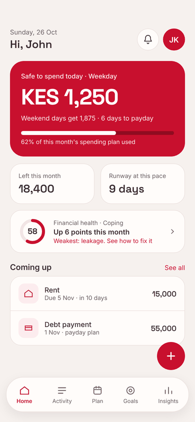
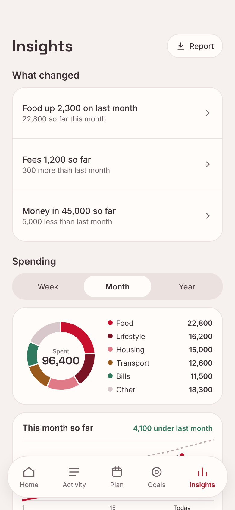
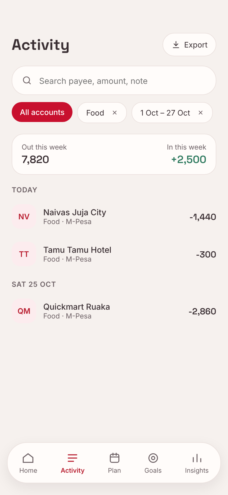
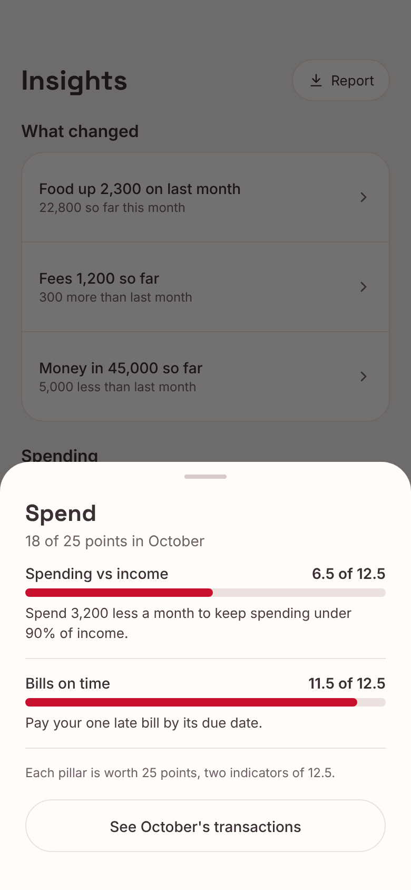
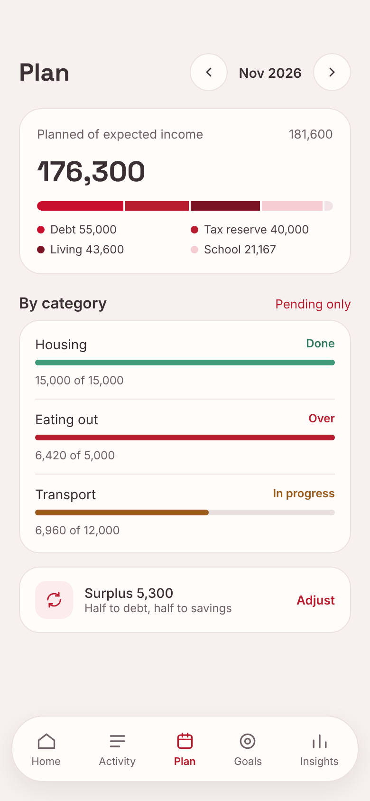
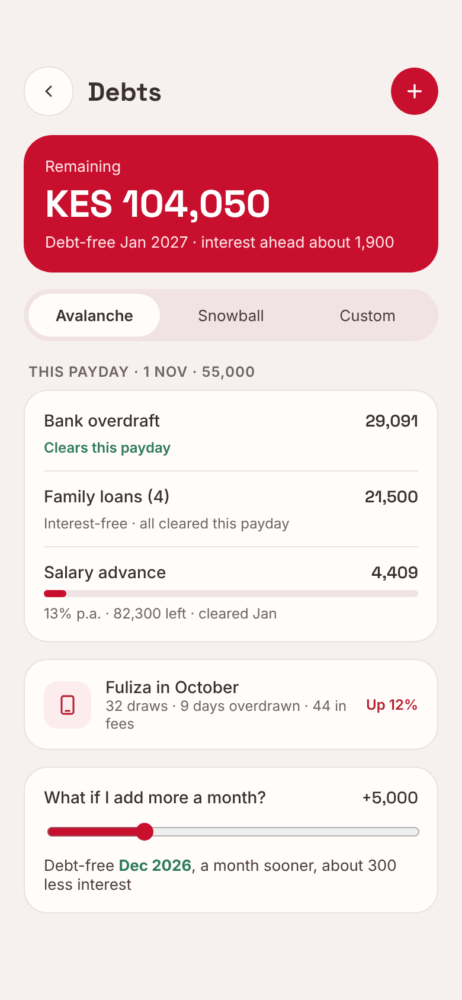

# Pesa Clarity app

[](https://github.com/pesaclarity/pesaclarity-app/stargazers)
[](LICENSE)
[](https://github.com/pesaclarity/pesaclarity-app/releases/tag/test-build)

Pesa Clarity is a free, ad-free, open-source Android and iPhone app that turns M-Pesa and bank SMS into a clear daily plan: what you can safely spend today, which bills are due, where money leaks, and when you will be debt-free. All analysis runs on the phone. This repository holds the Flutter app.

**Status:** pre-release, not yet in any store. Working: onboarding, SMS capture on Android and Shortcuts capture on iPhone, statement import, the review inbox with the message reader, Home (safe to spend, forecast, Financial Health Index), Balances, savings apps such as Chumz, Activity, Plan, Goals and debts, Insights, Ask (questions answered on the phone), subscriptions, base currency, balances from a double-entry journal, giving in the F-Droid build, encrypted backups, sign-in and app lock. The server is not deployed yet, so sign-in and the vault are off in builds without a server address.

**Download:** the newest test build is on [Releases](https://github.com/pesaclarity/pesaclarity-app/releases): [Android](https://github.com/pesaclarity/pesaclarity-app/releases/download/test-build/pesaclarity-play.apk) (`play`, most phones) or [for older 32-bit phones](https://github.com/pesaclarity/pesaclarity-app/releases/download/test-build/pesaclarity-play-32bit.apk), and the [F-Droid build](https://github.com/pesaclarity/pesaclarity-app/releases/download/test-build/pesaclarity-foss.apk) (`foss`, no Google services; [32-bit](https://github.com/pesaclarity/pesaclarity-app/releases/download/test-build/pesaclarity-foss-32bit.apk)). For iPhone, the [unsigned iPhone build](https://github.com/pesaclarity/pesaclarity-app/releases/download/test-build/pesaclarity-ios-unsigned.ipa) installs with SideStore or AltStore, which sign it with your own Apple ID for 7 days at a time; add the source `https://github.com/pesaclarity/pesaclarity-app/releases/download/test-build/pesaclarity-sidestore.json` in SideStore or AltStore to get each new build as an update (sign-in is off on it; it comes from the iOS build workflow, run by hand). The privacy policy and terms ship in `assets/policy/` and match the website. "Email me a copy" opens the phone's email app; with none, a signed-in person can have the server email the policy as text and a PDF (`POST /v1/privacy/copy`, which only sends a policy whose SHA-256 the server lists in `NGOME_PRIVACY_POLICY_SHA256`: `sha256sum assets/policy/privacy_policy.md`).

<p align="center">
  
</p>

| Home | Insights | One category |
| :---: | :---: | :---: |
|  |  |  |
| **Health score** | **Plan** | **Debts** |
|  |  |  |

Screens from the app's design, with made-up example data.

## Get involved

Pesa Clarity is built in the open, for people who live on M-Pesa and bank SMS.

- **Star this repo** so more people find a private money app that runs on their phone.
- **Add your bank or Sacco.** Each one is a small YAML pack with synthetic sample messages in [ujumbe-parsers](https://github.com/pesaclarity/ujumbe-parsers); no Flutter needed.
- **Pick a first issue:** [good first issues](https://github.com/search?q=org%3Apesaclarity+label%3A%22good+first+issue%22+is%3Aopen&type=issues) and [help wanted](https://github.com/search?q=org%3Apesaclarity+label%3A%22help+wanted%22+is%3Aopen&type=issues) across the project.
- **Report what reads wrongly** with a [new issue](https://github.com/pesaclarity/pesaclarity-app/issues/new/choose); leave out real names, numbers and messages.
- **Read [CONTRIBUTING.md](CONTRIBUTING.md)** before your first pull request.

The product spec, brand guide and design tokens live in [pesaclarity/docs](https://github.com/pesaclarity/docs).

## Quick start

You need Flutter stable (3.50 or later) and, for device builds, the Android SDK with JDK 17, or Xcode on a Mac for iPhone.

```sh
flutter pub get
dart run build_runner build --delete-conflicting-outputs   # Drift code generation
flutter run --flavor foss                                  # or --flavor play
```

Build a release APK:

```sh
flutter build apk --release --flavor foss --obfuscate --split-debug-info=build/symbols
```

Release builds use the debug key unless `android/key.properties` exists (see `android/key.properties.example`). Keystores never go in the repo.

For iPhone, see [iPhone](#iphone).

## Build flavours

| Flavour | For | Rule |
| --- | --- | --- |
| `play` | Google Play | May use Google services (Sign-In, Play Integrity) |
| `foss` | F-Droid | No Google services or other proprietary dependencies |
| `appstore` | App Store (iPhone) | No Google services. iPhone builds take no `--flavor`; they resolve to this one |

Dart code reads the flavour through `appFlavorProvider` (`lib/src/config/flavor.dart`). Android builds without a known flavour, including tests, behave as `foss`.

### Server

Accounts (sign-in, devices, delete account) talk to the Pesa Clarity server. People sign in with a 6-digit code sent to their email. `play` builds also offer Google sign-in through Android's Credential Manager when built with `--dart-define=PESACLARITY_GOOGLE_SERVER_CLIENT_ID=<web client id>` (the same id the server lists in `NGOME_GOOGLE_CLIENT_IDS`). Its Kotlin lives in `android/app/src/play/` and its libraries are `playImplementation` dependencies, so `foss` builds carry no Google code and sign in by email only. Set the server address at build time:

```sh
flutter run --flavor foss --dart-define=PESACLARITY_API_URL=https://api.example.org
```

Only `https` is accepted, apart from `http://10.0.2.2`, `localhost` and `127.0.0.1` for local development. Without it, the app works fully without an account and sign-in explains that accounts come in a later update.

## Project layout

```text
lib/
  main.dart
  src/
    app.dart                 root widget
    config/                  build flavour (play, foss, appstore) and server settings
    core/backup/             .pcbackup format: AES-256-GCM, Argon2id, recovery key (pure Dart)
    core/network/            pinned HttpClient factory (trusted roots per host, from build config)
    core/integrity/          Play Integrity stub, App Attest (iPhone), foss no-op, request header hook
    core/money/              Money (integer minor units), base currency and formatting
    domain/                  pure-Dart money rules, no Flutter or database imports
      time/                  calendar dates and months in the person's timezone
      ledger/                own transfers, Fuliza fees, noise collapse, honest totals
      budget/                safe to spend today, weekday and weekend limits
      plan/                  monthly plan, arrears, category status, surplus split, snapshots
      payees/                identifier normalising and matching, payee and override precedence
      categories/            default category set (keys shared with the categoriser)
      categoriser/           categoriser input, rules fallback, model manifest
      reader/                message reader input, decoding, rules reader, saved layouts
      tags/                  tag names, filtering and totals by tag
      debts/                 payoff strategies, payday split, family loans, Fuliza tracker, repayment matching
      savings/               savings apps the app knows (Chumz), their pockets, interest from typed balances
      health/                Financial Health Index: eight indicators, bands, best action
      forecast/              cash-flow forecast to month end: zero date, charges that may fail
      subscriptions/         recurring charges and their totals
    data/
      database/              Drift tables, SQLCipher connection, key store
      repositories/          thin repository interfaces and Drift implementations
    features/                one folder per area: onboarding, home, activity, plan, goals,
                             debts, lending, insights, profile, backup, privacy, accounts,
                             auth, security, reminders, export, payees, categoriser,
                             currency, timezone, subscriptions, statements, review, sms
    routing/                 go_router: five-tab shell; Profile under Home, Debts under Goals
    shared/adaptive/         shared dialog, picker, choice and grouped-row helpers
    shared/widgets/
    theme/                   brand tokens, light and dark themes, iOS and Android typography
test/                        unit, widget and database tests; screenshots/ draws the marketing screens
.maestro/                    Maestro UI flows (YAML), one per journey
tool/                        UI flows, F-Droid prep, release build, Swift type-check, screenshots
android/                     Android project (applicationId com.pesaclarity.app)
ios/                         iPhone project (bundle id com.pesaclarity.app)
assets/fonts/                Space Grotesk and Inter, with their OFL licences
```

State is managed with Riverpod and navigation with go_router.

## Security baseline

From the spec's "Mobile security" section:

- Database encrypted with SQLCipher. The 256-bit key is generated on the phone and kept in Android Keystore-backed secure storage. The app refuses to open the database if SQLCipher is not loaded.
- `FLAG_SECURE` on the main activity blocks screenshots, screen recording and app-switcher previews in release builds, from the moment the app starts, unless the person allows them: Profile › Security › **Allow screenshots and screen recording** (Android only, off unless switched on). When it is on, the app clears the flag each time it starts, as soon as it has read the setting, so every screen can then be captured, the lock screen included; if that call fails, the app stays blocked. Switching it off sets the flag again at once (`ScreenCaptureChannel.kt`). The setting is for the whole phone, like app lock, and is kept with app lock's settings in secure storage, outside the database, so no backup holds it: a restored or reinstalled app starts blocked. Debuggable builds never set the flag, so the UI flows can capture screenshots; release builds are never debuggable.
- Android auto-backup and device transfer are off (`allowBackup="false"` plus extraction rules that exclude everything).
- Permissions: `READ_SMS`, `RECEIVE_SMS`, `POST_NOTIFICATIONS`, `RECEIVE_BOOT_COMPLETED` (to restore reminders after a restart), `INTERNET` (sign-in, backups and the privacy policy), and `BLUETOOTH_CONNECT` (`BLUETOOTH` before Android 12) for a receipt printer a business pairs, asked for only when it chooses one. `test/android/manifest_permissions_test.dart` fails if the list changes. Cleartext traffic is off.
- Cleartext traffic is refused. Every `HttpClient` comes from `HttpClientFactory` (`lib/src/core/network`). Our servers are pinned to their certificate authorities, not their keys, because the hosting providers renew certificates with new keys every few months: connections to the hosts in `PESACLARITY_PINNED_HOSTS` trust only the roots in `PESACLARITY_TRUSTED_ROOTS` (two or more), and a misconfiguration refuses every connection. Third-party services (Google Drive) use the platform's authorities. A test fails if code creates an `HttpClient` any other way. The real values are set once the server is deployed.
- Device integrity: `IntegrityAttestor` (`lib/src/core/integrity`) supplies a token header for backup and federated-learning requests; the `play` stub returns "unavailable" until the Play project exists, and `foss` never attests. A light root and tamper check (`DeviceIntegrityChannel.kt`) shows a one-time notice in Profile and never blocks use.
- Dependencies are scanned with OSV-Scanner by `tool/check` before each push (`tool/check --deps` on its own) and updated by Dependabot.
- R8 minification and resource shrinking on release builds; Dart obfuscation via `--obfuscate`.

- App lock: with a PIN (and fingerprint or Face ID) set, the database key is released only after unlocking (`UnlockedDatabaseKeyStore`).
- One look: every screen does the same job the same way, from shared pieces in `lib/src/shared` (title rows, section labels, tiles, rows, tags, notes, sheets, dialogs, loading, error and empty states) and the spacing in `lib/src/theme/layout.dart`. The rules are in the docs repo, `brand/ui-rules.md`. Amounts never split, shrink or get cut: `FigureText`, `FigureTile` and `FigureRow` (`lib/src/shared/widgets/figures.dart`) keep each number whole, and tiles go two to a row, then one, when a figure would not fit.
- Hiding amounts: one eye (`AmountsEye`) hides every amount across the app, starting from "Hide balances on open". `AmountsHiddenScope` at the app root puts its state over every screen and sheet; screens format amounts with `shownMoney` or `shownAmounts` (`lib/src/shared/widgets/amounts_hidden.dart`). The eye sits at the right of each screen's title, or on the red card a screen leads with. The counter (Sell, Pay, tabs, Close the day, the record sheets), forms and documents to share or print always show amounts.

Not done yet: StrongBox-backed keys, the pinned hosts and roots for the deployed server (set at build time once it is live), and real Play Integrity tokens (the `play` attestor is a stub until the Play project exists; iPhone uses App Attest).

Releases: see [RELEASING.md](RELEASING.md), [docs/reproducible-builds.md](docs/reproducible-builds.md) and [docs/performance-budget.md](docs/performance-budget.md). F-Droid store text lives in `fastlane/metadata/android/en-US`.

## SQLCipher

The database uses `package:sqlite3` 3.x with its SQLCipher build, chosen in `pubspec.yaml` under `hooks.user_defines.sqlite3.source`. This replaces `sqlcipher_flutter_libs`, which reached end of life when `sqlite3` 3.x began bundling SQLCipher itself. In the `play` build the hook downloads checksum-verified SQLCipher binaries (with OpenSSL) from the `sqlite3.dart` GitHub releases. The `foss` build compiles the same SQLCipher release from source with LibTomCrypt (`tool/prepare_foss.sh`, `tool/foss/build_sqlcipher_sources.sh`); the database format is the same, so backups move between the two.

## Fonts

Space Grotesk (numbers and titles, tabular figures) and Inter (body text) are bundled in `assets/fonts/` as variable fonts. The app never fetches fonts over the network. Both are under the SIL Open Font License 1.1; the licence texts sit next to the font files. To update them, take `ofl/spacegrotesk/SpaceGrotesk[wght].ttf` and `ofl/inter/Inter[opsz,wght].ttf` from [google/fonts](https://github.com/google/fonts).

## Parser package

SMS parsing comes from the `ujumbe` Dart package in [pesaclarity/ujumbe-parsers](https://github.com/pesaclarity/ujumbe-parsers), a git dependency pinned to a commit (switch back to a release tag, `v0.4.0` or later, once one includes it). The institutions in My accounts are its bundled parser packs: each pack gives the id, name and sender IDs.

## SMS capture

- **iPhone.** Messages arrive through a Shortcuts automation instead; see [iPhone](#iphone).
- **Only selected senders.** The Android side (`SmsChannel.kt`) queries the inbox and listens for `SMS_RECEIVED` with the sender IDs of the ticked institutions; every other message is filtered out before it reaches Dart. The Dart parser filters by sender again.
- **Permission.** `READ_SMS` and `RECEIVE_SMS` are asked for only after a screen that says in plain words what is read, kept and discarded. Refusing is fine: onboarding goes on without messages.
- **How money comes in.** Setup asks "How does money usually come to you?" (salary, business, gigs, family support, allowance, seasonal, nothing steady; several at once; changeable in Profile). `IncomePattern` learns from the ledger how often money arrives and from how many people; borrowing, reversals and own transfers never count. A salary alone with a Plan budget keeps the monthly safe to spend. Everyone else gets `UntilNextMoney`: day-to-day money on hand, less bills due before the next money and a 10% buffer, spread over the days until the next money (a learnt rhythm such as support every 14 days, else a rolling 7 days, or how long it lasts for seasonal and between-jobs), but never more than is usually spent on a day like today (the last four weeks, weekdays and weekend days apart). Anything above a usual day stays spare; with under two weeks of history, money with no fixed next day is spread over 30 days. See [Income for everyone](https://github.com/pesaclarity/docs/blob/main/spec/income-for-everyone.md).
- **What was this?** Money in from people can be Support from family, Allowance and bursary, Gifts received, Money received, or business income (categories version 3, shared with pesaclarity-ml). When a sender's money has meant different things (the person files it differently from the payee's category or from earlier money), the payee is marked to ask (`Payee.askPurpose`, also a switch in the payee sheet). Later money in from them takes no category until answered on Home or in the transaction sheet: family support, payment for work, a loan to you (adds it to Debts as a family loan, linked to the money), paying you back (links it to the oldest money lent to someone of that name, which it lowers), a gift or a sale. "Always use this" sets the payee's category and stops asking. Money out to them still takes their category.
- **Lent and borrowed from a transaction.** In Personal, Household and Something else spaces, the category picker (from the transaction sheet, or an uncategorised row in Activity) leads with what the money can be between the person, friends and family (`LoanLink`, `LoanLinksRepository`). Money out: **I lent this** opens the loan sheet as "I lent", filled in with the payee as "Lent to", the amount and the date, and saving makes the lent loan linked to the transaction (`transactions.lent_loan_id`, schema 46; the category is Money lent, made the first time); **Paid back a loan** links it to the oldest family loan still owed to that person (`debt_id`), which it lowers. Money in: **A loan to me** and **Paying me back**, the same answers as What was this?. Choosing Money lent from the list is I lent this (or Paying me back for money in). A linked transaction is neither spending nor income: money lent and paid back is `LedgerRole.lending`, posted in the journal against Owed to you, and money borrowed and paid back posts against Borrowed, so In and Out, category totals, safe to spend, Insights and Plan leave them out (paying back a family loan still counts as a debt payment). Choosing another category unlinks it and takes back what it made: the lent loan (what paid it back is left uncategorised) or the family debt; a payment only loses its link. Removing a lent loan in Lent and borrowed does the same to its transactions. Activity names a linked transaction in place of its category ("Lent to Grace", "Borrowed from Grace", "Paid back by Grace", "Paid back to Grace"), and Ask's "Who owes me?" counts what came back. Business spaces keep customer credit in People and offer none of this. On Goals, the Lent and borrowed card sits under the goals, above net worth.
- **Make it last.** For a few days after money arrives (when Home plans until the next money), Home offers "Money in · KES 5,000 from …". The plan lists the bills due before the next money, the 10% kept back, and a daily amount to the last day; when the usual pace would use the money up first, it says when. "Use this plan" or a chosen daily amount (`MakeItLastPin`, setting `income.makeItLast`) fixes Home's daily figure ("Your plan for today") through that last day, until newer money arrives.
- **Week by week and rainy day fund.** For business and gigs, Home shows this week's money in and out and opens Week by week (`/home/week`): this week against a usual one (the median of the 8 weeks before), the last 5 weeks as bars, and the rainy day fund. A good week suggests half the extra for the rainy day fund, once a week, up to its target of one usual week's spending; a lean week offers to take what it falls short of usual spending. The rainy day fund (`Rainy day fund`, setting `income.fund`) is money set aside inside the app: it stays in the accounts and is kept out of safe to spend.
- **Spaces.** One app can hold several spaces (Personal, a business, more), switched from the chip at the top of Home. Each space has its own SQLCipher file (`pesaclarity-space-<id>.sqlite`; Personal keeps `pesaclarity.sqlite`), opened with the same device key and PIN, so its accounts, categories, Plan, goals, insights and settings stay apart; SMS capture writes to the open space. Personal's database also keeps app-wide settings (onboarding, timezone, consent, device warning) and the list of spaces (`mainDatabaseProvider`). The open space's id is kept in a plain `active-space` file so it can be read before the key is released. A new business space starts planning week by week and goes on to pick its accounts. Each backup run copies every space, each in its own file (`pesaclarity-<space>-<time>.pcbackup`; Personal keeps `pesaclarity-<time>.pcbackup`), and the vault keeps each space's newest copies apart (`X-Backup-Space`, pesaclarity-backend). Restore lists only the open space's backups and replaces only that space: each backup names the space it is a copy of, and a file of another space is refused ("This backup is of another space. Open that space, then restore it there."); a file from before backups named their space is refused when one of it and the open space is Personal and the other is not. All spaces share the one signed-in account.
- **Kinds of space.** A space is Personal, Business, Household, Savings group, Rental property, Farm or Something else. Each new space records its kind (`space.kind`) and starts with its own categories (`categorySeedsFor`): for example sales, stock, wages and "Paid yourself" for a business; contributions, payouts and loans to members for a savings group; rent collected, repairs and caretaker for a rental; harvest sales, seed, fertiliser and labour for a farm. Fees, tax, loans, own transfers, airtime and transport stay in every kind. Home for a space that is not Personal leads with its own figure (`SpaceSummary`): profit this month for a business or rental, profit this season (6 months) for a farm, what is left for a household, the pot and who paid in for a savings group, and the balance otherwise, with the largest categories and what you paid yourself. "Paid yourself" is an own transfer, so it is never a cost.
- **One space reads each account.** An account is switched on in one space only, or shared through Business or personal (Personal reads it and the business asks). Switching on in Add or remove accounts an account another space reads leaves it off and says where it is read ("Personal reads M-Pesa"); in a business it leads to Business or personal. An account a business and Personal both had on from before is shared with that business when it next opens (or, in any other kind of space, left to Personal), so each message is read once. Each message is also stored in one space: a message another space holds is never stored again, whichever space reads its account now, so choosing Only this business reads from then on and Personal keeps what it read. Once on update, each space drops its copies of messages that the space reading their account holds too, unless the person moved the payment there or made it that space's own (a sale, a record, a category, a payee, a note, tags), in which case the reading space's copy goes as a move would take it; both journals are posted again.
- **Money between spaces** ([decision 0027](https://github.com/pesaclarity/docs/blob/main/decisions/0027-money-between-spaces.md)). An account lives in one space; a transaction on it can be switched to any space and then shows only there (transaction sheet › Switch to another space, or Business sale and Business cost on a shared line, `SpaceMoveRepository`). One read from a message or statement goes to the other space on the owner's account there ("Your M-Pesa", `AccountType.ownersAccount`), with its amount, time, name, category (money in to a business is filed as Sales unless a category with the same key or the one chosen says otherwise), fee and code, but no balance; the space where the account lives keeps a balance record (`balance_records`: amount, time, fee, code, the balance its message printed and the link), posted against Held for that space (`AccountType.heldForSpace`). Balance records are in no list, total, report, search or export: only the journal and the balance check walk them, so each reported balance still adds up and the message is never read in again. Switching back turns the record back into the transaction. A payment typed by hand on an account no messages are read into moves outright. In the journal, Held for is a liability, the owner's account an asset, and a purchase with the business's money ("This was for me", `AccountType.paidBySpace`) posts against Paid by that space, which counts in neither money in nor money out (`LedgerRole.betweenSpaces` for what is neither side's income or spending). Personal's Home, On hand and Balances say how much of an account is another space's ("KES 650 of this is Vegetable stall's", or "Vegetable stall owes you KES 350"), and safe to spend and the forecast leave it out; a business's Money shows "On your M-Pesa" (or, below zero, "You have put in", not counted as its money). Pay yourself can take from the owner's line, no more than the business has on it, with both sides written at once; "This was for me" on a payment out of the business's own account makes it Paid yourself there and the purchase in Personal, spending only. On a line used for both the channel decides first: money into the owner's Pochi, or a till or paybill named in Business or personal, goes to the business; money sent to the owner's number is personal unless "Customers also send money to my number" is on (lines shared before this keep asking); a till not seen yet is asked about once. The message rules that tell those channels apart wait for the owner's samples (`receivedThrough`). Records from before are put right once after the update (`MoneyRepair`), after each space's copies of messages another space holds are taken out (`repairSpaceLeakOnce`, run first in every space), so only moves are left to put right: a locked copy of every space is kept for 30 days, each moved copy becomes the linked entry on the owner's account with its balance record where the account lives, accounts only moves made are removed, and one question is asked for a business whose M-Pesa balance had been typed. Deleting a business with money still on the owner's accounts asks: "It is mine now" files it as pay from the business, "Keep it apart" leaves it held for it. Put money in (Today › More ways to record) is the owner's own money into a business, never owed back: "Put in by you" in the business (`ownerCapital` in the journal), "Put into my business" in Personal, so it is neither a sale nor spending and counts in neither Out nor the Plan; staying on the owner's M-Pesa both sides are written at once, otherwise each side waits for its own message (`PutMoneyInController`). Pay yourself from a business bank asks "Where it lands": one of the owner's accounts in Personal, whose message is then matched to the pay and counted once, or "Not tracked here", counted at once with no Personal account going up; the account used last time is chosen first. After a space is restored, payments whose linked side is missing in the other space show as "N payments on one side only" in the space that is short (`restore_check.dart`): make them again (in a business without names or categories: money in as Sales, money out not yet sorted; in Personal in full), leave them apart, or, for a business, "They were mine". Clear data on a business asks the delete sheet's question when what is cleared holds its money on the owner's accounts; "Keep it apart" keeps that as the owner's account's opening amount. Every message behind a transaction that is switched, cleared or removed as a copy is set aside by its hash (`set_aside_messages`); `moved_transactions` holds only moves from before, until the repair.
- **Which space opens.** Your spaces › Open the app in: the last space used (the default), a chosen space, or Ask each time, which shows "Which space?" after unlocking. The choice is kept in a plain `open-space` file beside `active-space`, so `main` reads it before the key is released.
- **Scans.** "Scan my messages" reads from the start chosen under "Read messages from" (`ScanRange`): every message by default, or the last 3, 6 or 12 months, or from a date. Afterwards, when the app opens and every time it returns to the front, it reads what arrived since the last scan (from that start for a newly ticked institution), and in between it adds new messages as they land (`liveSmsCaptureProvider`). That catch-up reads every space's accounts, not only the open one's: after the open space's own, each other space's database is opened in turn, read into with that space's own rules (one reader per account, its M-Pesa lines, messages another space holds left alone, own transfers paired, Personal's shared lines sorted) and closed again (`every_space_catch_up.dart`), so a business's balances keep up while Personal is open. Changing the start in Profile › My accounts clears the scan marks, so the next scan reads again from the new start; messages already read are skipped by their hash. The phone passes a message on only while the app is awake, and many phones put apps in the background to sleep (Samsung's sleeping apps, Android's freezer for cached apps), so messages that arrive while the app is closed or asleep wait in the inbox for the next scan; there is no background service. Without SMS access nothing is read; once it is given in the phone's settings, reading starts the next time the app returns to the front.
- **Parsing** runs on a background isolate. A parsed message keeps its fields (amount, time, fee, receipt, balance, counterparty) and a SHA-256 hash; the text is discarded. Each institution gets its own account, created on its first transaction. A message one institution sends about money on another's account (KCB confirming an M-Pesa payment to its paybill, or money from a KCB account into M-Pesa; ujumbe's `institution` on the rule) goes on that other account, even when its own messages are not read. A message that names no account of its own, such as a card payment abroad, goes on the account in the institution's currency, keeping its own amount and currency. Transactions are deduplicated per account by ujumbe's dedupe key (receipt, amount and minute), which statement imports share. Two messages about the same money on one account are kept as one transaction (`twinMatch`): the same reference within a day, or a plain account alert (no reference) and a message with one, the same amount and way, within 15 minutes; the one with the reference wins and the alert fills what it lacks. Two alerts without references always stay two. A card payment in another currency and the account's own debit for it, within 15 minutes and within 10% of the day's rate, become one, the original amount kept with the rate the person got. Money out whose message names the number of one of the person's other accounts (a PesaLink to their Loop account, an M-Pesa payment to KCB's paybill for their own KCB account) is an own transfer, and pairs with the other side first, by that number. A loan repayment message (KCB's salary advance) is a debt repayment, never spending: it is linked to the debt of that name in Debts, created the first time, with the balance the message states. Counterparties are normalised with `PayeeIdentifier`, so named payees apply.
- **Review inbox.** A message from a selected sender that no rule matches is kept for review, text included. It lives only in the SQLCipher database and its text is deleted when the item is resolved; the hash stays so a later scan does not bring it back. Home shows "N messages to check"; each one opens with the message reader's suggestions to confirm, and "Read messages like this the same way" saves the layout (the words around the fields, numbers only as their layout, fields as empty slots) so later messages like it are added during capture. See [spec 0004](docs/specs/0004-message-reader.md).
- **Message reader.** `lib/src/domain/reader/` implements pesaclarity-ml's reader input (`docs/READER.md`), checked against `test/fixtures/reader/reader_vectors.v1.json`. The trained reader ships as `assets/models/reader/reader.weights` with `reader-manifest.json` and runs on rayo (`lib/src/features/review/data/rayo_reader_runtime.dart`): exported by pesaclarity-ml (akili 0.2.0 at f830212, `akili reader`, from pesaclarity-ml#56; weights SHA-256 `b82f31284b852a21d2d8e7136f8e6b7e3decb73964031bd9ba01e607fe00b70d`, 188,052 bytes), a PyTorch model exported through ONNX and quantised to int8 by rayo-convert, trained on synthetic messages only and licensed CC BY-SA 4.0 like pesaclarity-ml's other weights. The app checks the file's size and SHA-256 against the manifest, opens it once, the first time a message needs reading, and runs each message as rayo's two inputs, `tokens` and `shapes`, with `T` bound to 96: about 0.5 ms on one core of a 2.1 GHz Xeon. The message being checked is read on the UI thread; Home's count of messages to check reads them all in a short-lived isolate, on a second rayo session. The graph needs rayo's `reduce` and `reshape` ops (rayo 054c831 on, the commit pesaclarity-ml exports and scores the reader with); rayo is pinned at cdd7f55, which builds without fused multiply-adds (`-ffp-contract=off`), so its outputs no longer depend on the compiler or its flags, checks untrusted model files and text against limits (a failed bind no longer crashes a session), and has faster kernels for phones' CPUs, with the same floats. `test/features/review/message_reader_test.dart` checks rayo's outputs against `test/fixtures/reader/reader_decodes.json`, recorded from the same file on the app's own rayo build by `tool/reader_decodes.py`, which also checks them against the PyTorch model: bit for bit on the platform they were recorded on (Linux x64), within 1e-5 with the same labels elsewhere, since another platform's C library may round `exp` or `tanh` differently. Where rayo cannot load, or the files are missing or do not fit, `RuleMessageReader` reads currency amounts, dates, times and payees with plain rules. Its suggestions are worked out each time a message to check is shown, never stored, so a new reader needs no reading again: messages waiting in review get its suggestions at once, and what the person confirmed stays as they confirmed it. To update it: export with pesaclarity-ml (`akili reader`), copy `reader.weights` and `reader-manifest.json` here, then re-record with `tool/reader_decodes.py` and that export's `reader.onnx` (steps in the script).

## Balances

Profile › Balances shows what each account holds now, and whether it matches its messages (`lib/src/domain/ledger/balances.dart`, `lib/src/features/balances/`).

- **From the journal.** An account's balance, On hand and safe to spend read the journal (see [Books](#books)). A balance a parser rule or statement reported, or one the person set, is a check against it; a gap the records do not reach stays in Not yet sorted and moves to Balance corrections only when the person adds a correction. A balance the message reader suggested or the person typed while checking a message is only a claim. It counts once it is within one unit of the last checkpoint plus the entries since.
- **Fuliza is a debt on M-Pesa** (`fuliza_debt.dart`). The owed amount comes from the latest total a Fuliza message prints, with daily charges worked out between totals. M-Pesa's balances show what Fuliza did, even without its message. A payment that leaves the wallet at 0 though it took more than the wallet held was covered by Fuliza, so that is owed. Money in while Fuliza is owed repays it first. Any balance above 0 means nothing is owed. While Fuliza is owed, M-Pesa shows below zero and On hand on Home counts it. "Fuliza is paid" on Debts and the M-Pesa sheet clears it with a visible correction.
- **Fuliza is optional** (`fuliza_tracking.dart`). Not everyone uses Fuliza, so it shows only once a Fuliza message (a draw or a repayment) has been read: before that no Fuliza owed shows on Home, Balances, My accounts or Debts, and Ask never names it. My accounts then has a **Track Fuliza** switch, on by default and kept in the space's settings. Off, Fuliza is hidden everywhere: M-Pesa shows the balance M-Pesa reports, Fuliza's charges count with fees, and Activity leaves out its draws and repayments. The books do not change either way: Fuliza is still posted as above, so balances, In and out, safe to spend and Not yet sorted stay as they were, and switching it on again shows everything.
- **Balance check.** Check all balances goes through every message with a balance. Where two don't agree, it names the likely cause. The gap sheet lists the whole day, messages waiting to be checked, rows in other accounts, Fuliza and copies, and ranks the likely missing one (`gap_leads.dart`). **Add what's missing** adds the gap as a real transaction placed between the two messages, so the plan and insights count it. **Where it went** sums up, for each account this month, what went on fees, on Fuliza charges and on gaps nothing recorded explains. Gaps of 1.00 or less match.
- **Set the balance** records the difference to what the account really holds as a balance correction. The correction shows in Activity, is never income or spending, and can be undone.
- **Add an account** makes an account with no messages, such as Cash, with its currency and the balance today.
- **Own transfers** pair with a fee allowance after every new transaction, and a matched pair shows as one line in Activity. Sides in one currency pair and are suggested by the amounts in the currency the money moved in; sides in two currencies pair by their own rule (see [Currencies](#currencies)). In the journal both sides go through Money in transit; once they are paired, what was lost on the way is the transfer's fee (more arriving than left is Not yet sorted), so nothing is left there. A transfer the person named waits there for its other side; a pair in two currencies clears there through Currency exchange, one exchange entry per currency.
- **One message, one transaction.** A message already stored never makes a second row, however it is read again (catch-up, the live stream, Read messages again, a recheck). A bank's notice that money reached M-Pesa (KCB's "... received from JANE DOE - 987****654 ... via KCB", which its pack puts on M-Pesa) and M-Pesa's own message for it are one transaction when M-Pesa names the bank or the same sender (`message_twins.dart`): M-Pesa's message stays the record, with its receipt, time and balance. Two sides on different accounts that print the same transaction code are one own transfer, whatever either names. Once per space after an update, `balances_repair.dart` merges such pairs stored as two, removes rows made twice from one message, pairs transfers again and reposts the journal.
- **A transfer across currencies** moves money between accounts, so it changes On hand only by what the exchange cost: KES 13,050 out and USD 100.00 in at 1 USD = 129.20 KES (KES 12,920) leave On hand KES 130 lower. The dollar account is worth its amounts at the rates of their days, so later moves of the rate do not change it. Safe to spend does not move unless On hand is what limits it, and the forecast follows On hand.
- **Savings apps.** A savings app the app knows by the paybill its payments print (`savings_product.dart`; Chumz, paid through NABO CAPITAL LTD, is the first) can be kept as an account of the person's own: an ordinary savings account marked with the product (`accounts.product`, schema 41), in Personal only. Each payment into it stays on M-Pesa as its message has it and gets a mirror entry on the savings account, paired with it, so it is an own transfer, never spending, with its fee still a fee; money back from the app is the same the other way. Older payments become transfers when the app is added, new ones as they arrive, and the mirrors follow their payments through reading again, rechecks, copies and statement imports (`savings_links.dart`). Each paybill account code is a pocket, one goal in the app (`savings_pockets`), which a goal in Pesa Clarity can be saved in (`goals.saved_in_pocket_id`); it then shows what the pocket holds. The app sends no balance messages, so the person types each pocket's balance (`savings_readings`): what it shows above the money in and out is interest (income, under Interest, but never money arriving on Home), and anything else a correction. On the first balance a gap counts as interest only when it is at most 2% a month of what was paid in; otherwise it was there before the messages start. Interest and corrections are worked out again when older payments turn up (`settlePocket`). Money moved into any savings account, SACCO or money market, is filed under Savings unless the person or its payee chose another category, and counts as saved, so it meets a Savings line in Plan.
- **On screen** (`features/savings/presentation/`). Under the first payment to a savings app in Activity, a card asks once "Is this your Chumz savings?": **Add Chumz** opens a sheet with its name, the provider, how it is paid, each account code as a goal to name and lock until a day, and the balance (optional; one for each goal when there are several), and a line under the payment then says how many older payments changed; **It's not mine** stops the question and leaves the payments as they are. The app sits in its own Savings apps card in My accounts, and in Balances; its page shows the balance last typed with **Update balance** (which first asks which goal any money taken out came from), what was put in and taken out, the interest, the goals with their lock dates, and the money in and out, where an update can be undone; it also renames the app or removes it, which puts the payments back and counts as "It's not mine". Add or remove accounts offers it again. On Goals, a goal's sheet chooses which savings app goal it is **Saved in**; the goal then shows "Saved in Chumz" and its lock date, and what is saved is what that goal holds. Payments into the app have no Unmatch; they lead to its page.
- **The M-Pesa family of accounts** ([decision 0026](https://github.com/pesaclarity/docs/blob/main/decisions/0026-mpesa-family-of-accounts.md)). M-Shwari, Ziidi and Etica MMF are savings products the app knows from M-Pesa's own words (`keptOnItsOwn` in `savings_product.dart`), and like Chumz each is asked about before it is added (0026 item 5): "You have M-Shwari savings. Add it?" under its newest move in Activity. Until the person answers, its moves wait as own transfers under Own transfer, never income or spending, worked out as the ledger is read (`FamilyHold` in `savings_links.dart`, nothing written), and the wallet keeps the amounts its messages print. Add makes its account (`accounts.familyOf` names the M-Pesa wallet for M-Shwari and Ziidi; schema 45) and turns every move into an own transfer with a mirror entry, as for Chumz; "Not now" is remembered (`savings.declined`), the moves count as they did before (a send to M-Shwari as saving, money back as money received), and Add or remove accounts offers it later. M-Shwari's balance, which M-Pesa's message prints, is kept on the transaction (`other_balance_minor`) and sets M-Shwari's balance as a reading from the message (`savings_readings.from_message`); Ziidi and Etica follow the money in and out and any balance typed, the rest being returns (income under Interest). Etica's own notice (`etica` pack, account `000000M`) is the other side of the M-Pesa receipt with the same code (decision 0030), so the two are one move and no mirror is left. Money into the person's own Pochi la Biashara (`own_account: Pochi`) is asked about in the space that read it ("You have Pochi la Biashara. Add it?", at the top of Activity): until it is added there, its messages wait in the review inbox (`pochiAskReason`), off the records and never M-Pesa's money, and are read onto it on Add; "Not now" (`mpesa.pochiDeclined`) keeps them waiting and offers it in Add or remove accounts. Once added it is a Pochi account of its own (`reference` `pochi`) with the balance its message prints; on a line shared with a business, it is routed by its channel (`ChannelKind.ownPochi`). Records from before, plain sends or receipts to ZIIDI, M-Shwari or ETICA, wait for the question the same way; accounts the first version of this made without asking (`repairBalancesOnce`, version 3) stay, as added, so they are not asked about. Anything the person matched or set stays. My accounts shows "What you own and owe" and M-Pesa as a group of its members; Firefly III gets them as asset accounts. M-Shwari loans, Lock savings and KCB M-Pesa wait on message rules.

## Firefly III

Profile › **Firefly III** sends a space's transactions, one way, to a [Firefly III](https://github.com/firefly-iii/firefly-iii) server the person runs (decision 0029). It is off until they turn it on, and nothing goes to Pesa Clarity's servers (`lib/src/features/firefly/`, `lib/src/domain/firefly/`).

- **Connection.** The server address and a personal access token (Firefly III: Profile › Remote access and tokens). The token is kept in `SecureStore` only, never in a space's database, a backup, a log or a crash report. Check connection calls `GET /api/v1/about` and `/api/v1/about/user` and refuses Firefly III before 6.0. HTTPS is required; plain `http` only to a home network address (10.x, 172.16-31.x, 192.168.x, `.local`, `.home.arpa`, this phone) after a warning. Redirects are never followed.
- **Trust.** `HttpClientFactory.createForUserServer` reaches only that server's scheme, host and port, with the phone's authorities, or exactly a certificate whose SHA-256 fingerprint the person confirmed (asked again if it changes). Our own pinned client is unchanged.
- **What is sent.** Each space is a tag (plus `pesaclarity`); spending, income, fees (a withdrawal of their own to "Fees"), own transfers (one transfer, with a foreign amount across currencies), Fuliza and loans as liabilities (with Fuliza not tracked, no Fuliza liability: what it put into M-Pesa comes from "M-Pesa overdraft" and repayments go there), unnamed payees as "Not named yet". The mapping is worked out from the space's journal, so each account in Firefly III ends at its balance here; each account opens with its journal balance on the Send from day (1 January this year by default). External ids are `pesaclarity:<space>:<transaction>[:part]`. Money between spaces (decision 0027): a payment switched to another space is sent from that space, on the owner's account (an asset, read from the journal's owner's account), once; the balance record it leaves where its account lives is sent against "Held for <space>", a liability of type `debt` the person owes (`liability_direction` `debit`), never as income or spending, with the external id `pesaclarity:<space>:-<record>`. Put money in is sent from "Put in by you" into the business, and from Personal to the business, each once; the restore check's remakes are sent as the transactions and balance records they make. Every account there then ends at its balance here in both spaces.
- **Outbox.** Database triggers write `firefly_outbox` in the same write as each change while the space is sent (schema 42); the latest change wins. `firefly_sent` keeps the group of each part, the fields last sent (an edit sends only what changed) and a hash; a check by hash before each send queues what no single change wrote. `FireflyWhenOnline` sends after unlock and on each return to the app, quietly; problems show only on the Firefly III screen. A transaction that moves whole to another space (one typed by hand, or a copy going back to the space that reads its account) keeps its external id and is retagged; one switched onto the owner's account, or back, is deleted there from the one space and sent from the other; one the person deleted in Firefly III is not sent again unless they choose Send everything again. Turning off removes the token and what waits; what was sent stays there.
- **Tests.** `test/features/firefly/firefly_integration_test.dart` sends a made-up month to a real Firefly III and checks every account's balance; it is skipped unless `FIREFLY_URL` and `FIREFLY_TOKEN` are set. The recorded answers of Firefly III 6.7.9 are in `test/fixtures/firefly/`.

## iPhone

The iPhone app (`ios/`, bundle id `com.pesaclarity.app`, iOS 16 or later, iPhone only, portrait) shares all the Dart code. What differs:

- **Messages come from Shortcuts.** iOS lets no app read SMS. The app adds a Shortcuts action, **Add transaction from message** (`AddTransactionIntent.swift`, an App Intent that runs without opening the app). The person sets up a personal automation once: *When I get a message from MPESA (or their bank) → Add transaction from message*, passing the message and its sender. The action queues the message in `Application Support/shortcut_messages.json`, protected until the first unlock after a restart, so messages that land while the iPhone is locked still count (`MessageQueue.swift`). The `com.pesaclarity.app/sms` channel on iPhone (`MessagesChannel.swift`) uses the Android method names, so the scan service, live capture, parser and review inbox are unchanged: a queued message is added at once while the app is awake, and otherwise by the scan when the app opens or returns to the front. `ShortcutSmsSource` adds `release`, which drops queued messages once a scan has read them: only the senders it read, from where it started up to when it began. Every space's accounts are read on start and each return, and an M-Pesa message goes only once every space reading one of its lines has read it. Anything left unread is dropped after 35 days.
- **Onboarding** shows **Connect your messages** (`ConnectMessagesScreen`) in place of the SMS scan: the three steps, a button that opens Shortcuts, and whether a message has arrived. Profile links to it. Past months come from a statement import.
- **Look.** Profile › **Look** sets the theme (**System**, the usual, follows the phone; or always **Light** or **Dark**, through `MaterialApp.router`'s `themeMode`) and draws every text field underlined (the usual) or boxed, through the theme's input decoration, in every space and on every screen (`look.settings`, kept with the app-wide settings in Personal; `lib/src/features/look/`). A copy is kept with app lock's secure store and read before the first frame, so the lock screen and setup already use the look; once unlocked, the database copy wins and the lock copy is brought in line. PDFs always print light, in one palette built from the light theme, with brand red only for the logo and the rule or band at the top (`lib/src/theme/pdf_palette.dart`).
- **Look and feel.** iPhone uses the same design as Android (decision 0011): the theme sets the Android platform everywhere, so fonts, the pill tab bar, lists, dialogs, pickers and segmented controls match. iPhone keeps its swipe-back page transition and adds Connect messages (Shortcuts) and Files for backups. `lib/src/shared/adaptive/` holds the shared dialog, picker, choice and grouped-row helpers. `test/widget/iphone_test.dart` checks the iPhone build with `TargetPlatformVariant.only(TargetPlatform.iOS)`.
- **Native channels** in Swift mirror the Android ones: documents (backups to a folder picked in Files, kept as a bookmark), share sheet, device name and jailbreak signs. Google sign-in and Drive are absent, as in `foss`. iOS lets no app block screenshots, so the iPhone app never has, and Security has no **Allow screenshots and screen recording** row there.
- **App Attest** stands in for Play Integrity on vault uploads (`AppAttestChannel.swift`, `lib/src/core/integrity/app_attest.dart`). The first upload for a signed-in account registers a Secure Enclave key with the server (challenge, Apple's attestation, then `POST /v1/integrity/app-attest/keys`); each upload then sends `X-Pesaclarity-Integrity: appattest <key id> <assertion>` over the body's request hash. `Runner.entitlements` sets the App Attest environment to `production`, which must match the server's `NGOME_APP_ATTEST_ENVIRONMENT`.

Build on a Mac:

```sh
flutter build ios --release --no-codesign      # checks it compiles
flutter run -d <simulator or iPhone>           # Xcode signs with your team
```

To check the Swift without a Mac or Actions minutes, run `tool/swift_typecheck/typecheck.sh` (needs Docker). It type-checks `ios/Runner` with Linux Swift against stand-ins for Apple's frameworks in `tool/swift_typecheck/stubs/`; add any new Apple API there. It cannot link, sign or resolve CocoaPods.

### Install on your own iPhone with Xcode

For testers with a Mac. A free Apple ID works; the app then lasts 7 days before you run it again. A paid developer account makes it last a year.

1. Install Xcode from the Mac App Store, and Flutter stable (see Quick start). Open Xcode once to accept its licence and let it add the iPhone platform.
2. Get the code and its generated files:
   ```sh
   git clone https://github.com/pesaclarity/pesaclarity-app.git
   cd pesaclarity-app && git checkout dev
   flutter pub get
   dart run build_runner build --delete-conflicting-outputs
   ```
3. Open `ios/Runner.xcworkspace` in Xcode (the workspace, not the project). Select **Runner** › **Signing & Capabilities**:
   - **Team**: add your Apple ID in Xcode › Settings › Accounts, then pick it (a free one shows as *Personal Team*).
   - **Bundle Identifier**: change `com.pesaclarity.app` to something only you use, such as `com.yourname.pesaclarity`. Apple won't sign the project's own id for another team.
   - With a free Apple ID, remove the **App Attest** capability (the minus beside it): free teams can't use it. Sign-in then stays off, as on the unsigned build.
4. On the iPhone: connect it by cable and tap **Trust**. Turn on **Settings › Privacy & Security › Developer Mode** and restart when asked.
5. Back in Xcode, pick your iPhone as the run destination at the top and press **Run** (▶), or from the terminal: `flutter run --release -d <your iPhone>` (`flutter devices` lists it).
6. The first time, iOS blocks the app until you trust its developer: **Settings › General › VPN & Device Management** › your Apple ID › **Trust**. Then open Pesa Clarity.

Don't commit the changed bundle id, team or removed capability; they're for your phone only.

Without a Mac, use the unsigned build on Releases with SideStore or AltStore (see Download).

The `iOS build` workflow (Actions tab, run by hand) compiles an unsigned release and a simulator build on macOS. Swift cannot be compiled on Linux, so run it after changing `ios/`. App Store uploads need an Apple Developer account and signing, which are not set up yet.


Shortcuts only passes messages as they arrive; iOS gives no way to read the messages already on the phone. So iPhone setup offers "Past months › Import a statement" on the Connect step, which ends setup and opens the statement import for the months before.
## Currencies

- **Base currency.** Setup asks which currency the person counts in, suggesting their phone region's (from Unicode CLDR data in `lib/src/core/money/currency_data.dart`, generated by `tool/currencies.py`). It stays KES for installs from before the choice. Profile › Base currency switches it. The step never waits on saved settings: the suggestion shows and Continue works from the first frame, and a save that fails says so, with Try again.
- **Second currency.** Setup can add an optional second currency, None by default (`secondary` in the currency settings); Profile › Base currency › Second currency changes or clears it. Home shows Safe to spend and On hand in it too, under the figure, at the day's rate, and nothing without a rate. The converter starts with it. It is never the base currency: switching to it clears it.
- **Stored as paid.** Transactions and accounts keep the currency they moved in, and are converted into the base currency as they are read (`ledgerEntries`, account openings), with the original amount shown in Activity. Without a rate an entry keeps its own currency and stays out of base totals.
- **Typed in the base.** Plan items, goals, debts, money lent and subscriptions are in the base currency. Switching converts them once at today's rate, after the person confirms.
- **Rates.** The phone fetches today's rates from the public service in `PESACLARITY_RATES_URL` (an https template with `{base}`), at most every 12 hours; the request carries only the currency code. Builds use ExchangeRate-API's open endpoint (`https://open.er-api.com/v6/latest/{base}`) from `tool/rates.env` unless repository variables of the same names name another; `PESACLARITY_RATES_SOURCE_NAME` and `PESACLARITY_RATES_SOURCE_URL` set the credit line under the rates ("Rates by …", linking to the provider), which the open endpoint asks for. Rates the person sets win. Without a rates URL, only their own rates are used.
- **Rates by day.** The first rates fetched each day are kept (`rate_snapshots`, schema 29), so a transaction converts at the rates of its day, or the closest earlier day's, and later rates don't change it. One older than any kept rates uses the oldest, marked approximate. A transaction can carry the rate the person got (`fx_rate_currency`, `fx_rate_micros`: one unit of that currency bought this much of the transaction's), which wins over the day's.
- **Each amount in its own currency.** Activity shows a payment in the currency it moved in, with the base amount under it ("-KES 25,000", "≈ USD 193.50"), and codes on every amount once the list holds more than one currency. The payment sheet shows the rate used and where it came from, with **Use the rate I got**. A payment typed in takes its account's currency, and the cash account made for it is in the base currency.
- **Each amount in the currency its message shows.** Bank packs read the currency printed with the amount (`currency` group in ujumbe), and the message reader reads codes such as USD and EUR; a message that prints none is in its institution's usual currency. Amounts read in hundredths are rescaled to the currency's minor units. Totals convert every amount from its own currency into the base currency at the rate of its day.
- **Accounts at the same bank.** Messages print the holder's masked account number (`own_account`, such as `0170*****4321`); accounts at one institution are told apart by the digits it shows (`AccountReference`, `accounts.reference`, schema 30), then by currency, and named apart ("Equity Bank ···4321"). An account from before numbers were read takes the first number seen in its currency.
- **Past records fixed from messages.** After a pack update, the messages still in the inbox are read again once (`MessageRecheck`): each transaction moves to the currency and account its message shows, matched by message hash, and Activity says how many moved.
- **My accounts.** Profile › My accounts lists each account and its currency: from its messages for accounts that messages feed, and chosen for accounts added by hand (Cash), where a new currency applies to new amounts and the opening balance converts at the rate of its date. **Add or remove accounts** switches institutions on or off.
- **Own transfers across currencies** (`cross_currency_transfers.dart`, [plan](https://github.com/pesaclarity/docs/blob/main/plans/currencies-stage-2.md)). Money out of one of the person's accounts and money in to another in another currency, such as KES 13,050 out of KCB ···4321 and USD 100.00 into KCB ···8765, are one transfer. They pair by themselves after the same-currency rule, at the rates kept with the space: within 30 minutes and 5% of the day's rate when both accounts are at one institution, and within 3 days and 10% when a message prints the other account's number or the person named it ("To another of my accounts"). Two institutions with nothing named are only offered by hand; with no rate for the day nothing pairs by itself. A side the bank reversed is never a side, and a pair whose side is reversed later is unmatched. Past history paired again once after the update (`ledger.ownTransfersPaired`, version 2). Both transactions keep their own amount and currency; nothing new is stored, and no schema change.
- **What the exchange cost.** The rate the person got is the ratio of the two amounts; the cost is the money out less the money in, each at the rate of its day (KES 130 in the example). It counts with fees on the day the money arrived, in Activity's Out, Insights, Leakage, the Health Index and the reports; more in than the day's rate gives is a gain that lowers fees, never income. With no rate for that day, or only an approximate one, it is not known. In the journal the pair posts one exchange entry per currency, dated when the money arrived: Money in transit clears in each currency against **Currency exchange** (a trading account, zero in the base at the day's rates), and the cost goes to **Exchange cost**, an expense the business report shows beside fees. Exchange entries are posted again when a day's rate is kept later or the person sets a rate.
- **On screen.** Activity shows the pair as one line, the money out's amount with the money in's under it ("+KES 13,050", "→ USD 100.00"); its sheet adds the rate the person got, the day's rate and the exchange cost. "Was this your own money?" also offers money in another currency, in its own amount with the rate the two give, or "No rate for that day".
- **Currency converter.** Profile › Base currency › **Currency converter** converts any amount between any two currencies at the latest rates or the person's own, and shows it in their other currencies too; it works offline with the last rates.

## Ask

Questions about your money, answered on the phone from the open space's own records (ADR 0017, `lib/src/features/ask`). Nothing is sent anywhere and Ask has no federated learning.

- **Runtime.** Both models run on [rayo](https://github.com/pesaclarity/rayo) (AGPL-3.0), our own inference engine in plain C89 (pesaclarity/docs decision 0020), in both builds. It is a git dependency pinned to a commit on rayo's main (move it to the `v0.1.0` tag once that exists), and its build hook compiles its C from source for each target with the platform's compiler, so neither build ships a prebuilt ML library and nothing from Google runs the models. It runs TFLite's int8 arithmetic, so it gives TFLite's results. `lib/src/features/ask/data/rayo_ask_runtimes.dart` opens each model once, from its plain weights file with the graph in its header (pesaclarity-ml `docs/WEIGHTS.md`), and keeps one rayo session for the app's life: inputs and outputs are the session's own memory, and a run allocates nothing. Runs go in a short-lived isolate on that same session, so the UI thread never waits, one at a time. The app checks each file's size and SHA-256 against its manifest before rayo reads it; the manifests also keep the SHA-256 of the file the weights came from (the PyTorch reader's ONNX file, or the writer's TFLite file), for provenance, but the app ships neither.
- **Reader.** `assets/models/ask/ask-reader.weights` with `ask-reader-manifest.json`, exported by pesaclarity-ml (ask reader v4 in PyTorch, run 16, on pesaclarity-ml `dev`; weights SHA-256 `1dac0b7b9db60f843ed33a2578b2da2bcfddfb735c4a89c021ba443f2c121106`) from synthetic questions only, with thousands of invented payee and account names: rayo-convert's int8 quantisation of the PyTorch model's `ask-reader.onnx` (not shipped; its SHA-256 is the manifest's `source`) and rayo's graph for it, in rayo's general ops (`compare` and `masked_reduce` since rayo a64d855). A question takes about 0.2 to 0.35 ms on one core of a 2.1 GHz Xeon. Where rayo's library cannot load (a chip it was not built for), `DartAskReader` (`lib/src/domain/ml/`) runs the same file in plain Dart, in about 7 ms, each operation as rayo runs it in float32. The app's rayo gives the recorded outputs bit for bit, and the Dart reader the same labels with probabilities within 1e-4 of them. The app checks every label against what it knows, and otherwise uses `RuleQuestionReader`, which also takes over when the model is unsure or misses a name the rules find. To update it: export with pesaclarity-ml (`akili ask-reader`), copy `ask-reader.weights` and `ask-reader-manifest.json` here, then re-record the app's rayo's readings of the hard phrasings with `tool/ask_reader_decodes.py` and that export's `ask-reader.onnx` (steps in the script; it also checks them against the PyTorch model within the export's parity limits); `test/features/ask/ask_reader_test.dart` runs rayo and the Dart reader on them and checks both match.
- **Replies.** Worded on the phone by `assets/models/ask/ask-writer.weights` with `ask-writer-manifest.json`, exported by pesaclarity-ml (`akili ask-writer` at dfb9c24, the writer code unchanged in release v0.2.0; weights by `akili ask-writer-weights`) from synthetic replies only, about 590 KB. It reads the answer's facts as tokens (the kind of reply, flags such as "more than before", and which values there are) and writes words and placeholders only; the app fills every figure, name and date from its own answer (`ModelReplyWriter`, `lib/src/domain/ask/model_reply_writer.dart`). rayo decodes with a key/value cache: the facts run once, then one token per step, about 1 ms per reply on the host. Each reply must pass pesaclarity-ml's checker (no digit, only placeholders it was given, each once, the required ones there) and use no word that would name a category, person or day the facts did not give; otherwise the answer keeps its `TemplateReplyWriter` sentence, as it does when the writer's files are missing or do not fit, or rayo cannot load. The tests run the real model on rayo on Ask's requests on a synthetic scenario, through the same checks, and every reply must be token for token the one TFLite wrote for that request (`test/fixtures/ask/ask_writer_decodes.json`, recorded with the model's `ask-writer.tflite` by `tool/ask_writer_decodes.py`).
- **Numbers.** Every figure comes from the same providers the screens use: balances from the Balances screen's (the journal, Fuliza owed taken off), charges as Insights counts them, safe to spend from Home's.
- **Periods** (`lib/src/domain/ask/periods.dart`). "The last N months", however it is said ("the 3 months", "past three months", "over the last 3 months", "in these 3 months", "3 months", "miezi mitatu iliyopita"), is this month so far and the N − 1 before it: on 21 November, "the last 3 months" is 1 September to today, headed "Sep to Nov 2026", the same as the "Last 3 months" choice. "N months ago" is that one month; "the next" or "first 3 months" is no period. "The last N days" or weeks ends today; "since September" (or "tangu Septemba") runs from its first day; "this quarter" and "last quarter" are calendar quarters (on 21 November, last quarter is July to September). Counts may be words, English or Swahili. When a reader's period words read as none, the question's own words are read with the same rules; when no rule reads its words of time ("the last few months"), the answer says which period it is for ("I read this as this month; ask about “the last three months” …"), never answering for this month as if that was asked. With no words of time it is this month, as the heading says.
- **Money in** ("how much came in", "money got in", "did I receive", "pesa iliyoingia") is all the money that arrived (`isMoneyArrived`, `lib/src/domain/ledger/ledger_role.dart`): income, and money from people not named yet, which arrived though it is not income, a gift or a loan until they are named. Left out, and said beside the total: own transfers (money moved between the person's own accounts, savings included) and borrowing (Fuliza draws and loans, which are owed back). Reversals and refunds of the person's own payments lower spending instead, and balance corrections are never money in. The part from people not named yet is said after the total ("KES 12,400 of it is from people you haven't named yet"); "See all" opens Activity on money in, where they are named. Every "money in" figure counts the same (`LedgerTotals.moneyInMinor`): Home's "In · out" line (Personal, Household, Something else), Activity's "In this week", Insights' "Money in so far", week by week, the first insight's "Money in" and the income pattern. Income (`LedgerTotals.incomeMinor`, money from people not named yet left out until they are) stays what earned income means: the Health Index ratios, leakage as a share of income, Insights' report "Income", tax, profit, Sales and Rent, and Plan's income.
- **Conversations** are kept in the space's encrypted database for as long as Ask settings say, and backups leave them out.

## Support

Every feature is free; giving never unlocks anything (`lib/src/features/support`).

- **F-Droid only.** Only the `foss` build asks in the app. Play and iPhone show nothing about giving; it is on the website's Sponsor page.
- **Settings.** `PESACLARITY_SUPPORT_URL` is the https giving page, with `{amount}` for the amount in shillings or `{amount_cents}` for it in cents when the page takes one (the giving page is CitaPay's, `https://pay.citatech.cloud/pay/@pesaclarity?amount={amount_cents}`, whose `?amount=` is in cents); `PESACLARITY_SUPPORT_PAYEES` lists the payee names or numbers a gift's M-Pesa message shows, separated by commas (empty until the payee name on CitaPay's M-Pesa confirmation is known, so no thank-you yet); `PESACLARITY_SUPPORT_COSTS_URL` is the page on what it costs. Builds read `tool/support.env` unless repository variables of the same names are set. Without a giving page, nothing about giving shows.
- **The Home card** sits under the red card on Personal's Home: "Pesa Clarity is free". It never shows in the first 30 days, then shows for 3 days at most every 60, never while today's money is spent, the plan is used up or a payment may not go through, and never within six months of a gift. A tap rests it. **Don't ask me again** on Support ends it.
- **Support Pesa Clarity** (Profile, or the card) explains why gifts help, picks 50, 100, 200, 500 or another amount, and opens the giving page in the browser, where M-Pesa asks for the PIN. The app sends nothing until that tap, and the address carries only the amount.
- **Thank you.** A payment to one of the payees is read as a gift from its own M-Pesa message. When one comes in, Home says thank you once, and **Your gifts** lists each gift's day, M-Pesa code and amount, on the phone only.

## Spaces

Each space has its own encrypted database; no data is shared or read across spaces (`lib/src/features/spaces`).

- **Profile › Spaces** lists every space, where the app opens, Recently deleted, and Delete all my data.
- **A space's settings:** name, kind (any but Personal, after a warning of what comes in and goes away), what a business sells (products, services or both), and for the open space its accounts, base currency, day end, receipts and invoices, tax and backup. A space that is not open shows its name and kind, and opens for the rest.
- **Switching transactions.** Transactions are never edited, only recategorised or switched to another space. Long-press in Activity to choose several, then Switch to another space: they leave this space and go to the other, with the category chosen there, or matched for each one; payees stay. See Money between spaces above.
- **Clear data** removes a space's records (everything, or only a date range: its transactions, sales and quick records, and balances typed for savings apps) and keeps its name, accounts, categories, settings and the pockets of its savings apps. **Delete space** removes the space and its file (Personal cannot be deleted on its own; the name must be typed). Both can keep a locked copy for 30 days (`spaces.kept` in Personal's settings, the copy under `kept/`) and can also delete the space's backups in the vault and Google Drive.
- **Recently deleted** restores a copy into its space, or deletes it now; copies past 30 days go when Spaces opens. Restoring Personal (a kept copy or a backup) brings back its own records and settings only: what Personal's file keeps for every space (the list of spaces, Recently deleted with its copies' keys, and the Business or personal rules) stays as it is.
- **A deleted space's rules go with it.** The Business or personal rules that send money to a space (an account shared with Personal, people marked always business) are taken out of use when it is deleted: kept with its copy and put back if it is restored, gone with the copy otherwise. Every open of another space's file goes through `SpaceDatabases`, which refuses a space that is not on the list, so nothing is moved into, backed up from or made as a file for it; the app opens in Personal if the space it was to open is not on the list.
- **Delete all my data** asks for the app lock PIN (or DELETE without one), can also delete online backups and the sign-in, then removes every file and secret the app keeps and closes the app, which opens again at setup.

## Timezone

Every date, day start, month and export timestamp uses one timezone: the one picked in Profile › Timezone, or the phone's own (`UserTimeZone` in `lib/src/domain/time/calendar.dart`). It is a fixed offset, with no daylight-saving rules yet. Tests pin East Africa Time in `test/flutter_test_config.dart`, so they pass on any machine.

## Statement import

- **On the phone only.** The PDF and its password never leave the phone. The password goes straight to PDFium and is cleared once used.
- **Positioned words.** `PdfiumTextExtractor` returns each page's words with their boxes (`page_words.dart` builds words from PDFium's character boxes). ujumbe's statement packs pick the layout and rebuild the table from those positions, so columns and wrapped details survive; see the [statement import spec](https://github.com/pesaclarity/docs/blob/main/spec/statement-import.md).
- **Off the UI isolate.** PDFium runs on pdfrx's worker; layout and parsing run in `Isolate.run`.
- **Importing.** Rows match SMS by ujumbe's dedupe key, new ones are added, and the result is reconciled to the closing balance. A recognised bank with no statement pack yet shows "coming soon".
- **Fixtures.** `test/fixtures/synthetic_statement*.pdf` are synthetic M-Pesa statements (one AES-encrypted, password `0000`) made by `tool/fixtures/statement_pdfs.py`. Never commit a real statement.
- **F-Droid.** The `foss` build has no PDFium and hides statement import (`tool/prepare_foss.sh`).

## On-device categoriser

- **Features.** `lib/src/domain/categoriser/features.dart` is a Dart port of `akili.features` in [pesaclarity/pesaclarity-ml](https://github.com/pesaclarity/pesaclarity-ml) (feature schema version 1). `test/fixtures/categoriser/feature_vectors.v1.json` is a copy of that repo's conformance vectors, and the tests check every case. When the ML repo bumps the schema, copy the new vectors and port the change.
- **Model.** `assets/models/categoriser/categoriser.weights` with `model-manifest.json` and `labels.json`, exported by pesaclarity-ml (`akili train --config configs/dp-sgd.yaml`, pesaclarity-ml#79): the PyTorch categoriser, trained with user-level DP-SGD (ε 4.66 at δ 1e-6) on synthetic transactions only, with payees as the app gives them (the name alone, or a statement's details column, not the SMS's till number; taxis, coaches and flights, salary credits and transfers from people as statements word them), and quantised to int8 by rayo-convert, 75,776 bytes (SHA-256 `c97c8e0a…`). On invented statement payees it scores 0.82 (the model before: 0.72 on the same 302 rows; transport recall 0.07 to 0.56, salary 0.65 to 1.00). It ships in the app like the message reader and Ask's models. The app refuses it, and uses the rules below instead, when its weights format, feature schema, config, input or outputs differ from what the app reads and produces, or when the file's size or SHA-256 differ from the manifest; `source` (the ONNX file it was quantised from) is provenance only.
- **Runtime.** rayo, as for the message reader and Ask: `RayoCategoriser` (`lib/src/features/categoriser/data/rayo_categoriser_runtime.dart`) keeps one session, writes the encoded row as the graph's `features` input (int32 `[13]`, unchanged) and reads `category` (`[27]`, the softmax in `labels.json` order) in place. Where rayo cannot load, the same network runs in Dart (`DartCategoriserRuntime`), within 0.05 of rayo with the same labels. The tests check rayo against a recording of the app's own rayo library on the feature vectors' rows, bit for bit (`test/fixtures/categoriser/categoriser_decodes.json`, recorded by `tool/categoriser_decodes.py`, which also checks it against the PyTorch model).
- **Order.** With the model loaded, `RulesFirstCategoriser` (`lib/src/domain/categoriser/categoriser.dart`) decides each suggestion in this order:
  1. the person's own choice for the payee, then the payee's default category;
  2. the rules, when they are certain (`certainRuleConfidence`, 0.9): the message type settles the category (airtime, Fuliza repayment, charges, round-ups), or the payee is a well-known one in the rules' table (Naivas, Quickmart, Carrefour, Shell, Rubis, TotalEnergies, KPLC, Sportpesa…, also inside a statement's wording such as `Pay Bill to 000123 - SHELL`; `knownPayeeRuleConfidence`), a transport operator or app (Uber, Bolt, Little, Faras, SGR and Madaraka Express, Kenya Airways, Jambojet, or a matatu, taxi or boda boda in the name; Uber Eats and Bolt Food are eating out), or money in that names a salary or payroll (`SALARY`, `PAYROLL`, `WAGES`, `NET PAY`; a salary advance is a loan). The model is not run;
  3. the model, for everything else, guesses from a word in the payee's name (`mart`, `hotel`, 0.6) included. Money in from a person (M-PESA's received from a name, or a statement's `Customer Transfer from 0700***0nn - NAME`, with no business word such as `LTD` or `SACCO` in it; `fromPerson`) is one of money received, support from family or gifts, so the model's scores are narrowed to those three.
- **Without the model** (refused, or rayo and Dart both unable to read it) the rules categorise everything: the message type, then well-known payees, then words in the payee's name.
- **Applied automatically.** `AutoCategoriser` runs after each scan and import: the person's earlier choice for the payee always applies, rules and known payees apply at 60% confidence or more, and weaker guesses stay suggestions. The result sits in its own columns (`auto_category_*`), shows as Auto, and never overrides the person's choice or the payee's default; see `docs/specs/0001-auto-categorise.md`.
- **Your choices win.** Accepting or changing a suggestion sets that transaction's category and remembers it for the payee; the next transaction from that payee suggests the same category first. Each choice is also logged on the phone as encoded features and a label, never the payee text, for later fine-tuning.
- **Learning on the phone.** When the manifest's `fine_tune` block is one the app implements (`spec_version` 1) and its shapes are the weights file's, `ModelFineTuner` (`lib/src/domain/categoriser/trainable.dart`) fine-tunes the model on the open space's latest confirmations with the SGD step of pesaclarity-ml's `docs/FINE-TUNING.md`, in Dart: only `hidden` and `category` train, on `f`, the input of `hidden`, computed from the weights file as rayo runs it, and each run starts from the shipped tensors (`hidden.kernel` dequantised). The learning rate, epochs, batch size and example limits come from the manifest. The tuned tensors are kept in that space's encrypted database as float32 under their names, in rayo's `[out, in]` layout, tied to `weights_sha256`; suggestions in that space then run in Dart with them in place of the shipped four, and other spaces never see them. Weights tuned on another file (or on the old TFLite model) no longer fit and are ignored. `test/fixtures/categoriser/fine_tune_vectors.v1.json` is a copy of that repo's conformance vectors; every loss and weight must be within 1e-5. Nothing leaves the phone.
- **When it runs.** `LearnWhenDue` checks on open and on return to the app; `LearningSchedule` runs only with "Help improve the app" on, while charging (`charging` on the `com.pesaclarity.app/device` channel), and no more often than `fine_tune.min_hours_between_runs`.
- **Federated updates** are not built yet (step 2 of the federated learning spec); the interfaces are in `learning.dart`.

## Books

Each space keeps double-entry books (`lib/src/domain/books/`), the base for the business features in [docs/spec/business-money.md](https://github.com/pesaclarity/docs/blob/main/spec/business-money.md). Since journal stage 4 they are a view over the space's stored journal (`booksProvider`, `Books.of`), never stored themselves, so they always follow the records:

- Every transaction's entry is the journal's: money accounts against income or spending categories, fees, tax, savings, borrowing, money lent (Owed to you), own transfers or "Paid yourself", with Fuliza owed and charged as the balances show it and own transfers through Money in transit.
- Each account opens as the journal opens it. There is no balance difference plug: where a message reports a balance the records do not reach (a missing message, say), the gap stays in Not yet sorted until the person adds what is missing or confirms a correction.
- On top of the journal, only in the books: sales and purchases on credit, stock (bought to sell, sold, counted), money owed from before the records and tax a client withheld.
- Tests check that every entry balances, that the trial balance is zero, and that profit and balances agree with the rest of the app, including on random histories (`test/domain/books/journal_views_random_test.dart`).

**The journal** ([decision 0018](https://github.com/pesaclarity/docs/blob/main/decisions/0018-double-entry-journal.md), [plan](https://github.com/pesaclarity/docs/blob/main/plans/journal.md)). Each space's database also keeps a stored double-entry journal (`journal_entries` and `postings`, schema 34; stage 2 in schema 35). Every transaction, each account's opening and each reported-balance gap posts a balanced entry (`lib/src/domain/books/journal.dart`, `lib/src/data/repositories/journal_repository.dart`). System accounts are Not yet sorted, Money in transit, Fuliza owed (one per M-Pesa account), Opening balances, Balance corrections, Fuliza charges, and for own transfers across currencies Currency exchange and Exchange cost. It is append-only: database triggers mark each changed account, the journal syncs account by account, and a changed source posts a reversal and a new entry, never an edit. Since stage 2, balances, On hand, safe to spend and every figure of money held read the journal, once per change (`journalAtGenerationProvider`); Insights and the Health Index count Fuliza charges from it. Since stage 3, every fix is an entry: setting a balance, counting cash, a correction and undoing it, matching and unmatching a transfer, moving a transaction to another account or space, and removing a copy each post a reversal and a new entry, never an edit (`test/data/journal_fixes_test.dart`). A paired own transfer's money out clears Money in transit against what arrived, and a pair in two currencies posts an exchange entry per currency (currencies stage 2), so when only one side changes, the other side's account is reposted too. Clearing all of a space's data removes its journal with its records, and the journal starts again from the accounts kept. Since stage 4, everything else reads the journal too: Plan's actuals, Insights (totals, leakage, the spending chart, findings, the first insight and the report), Activity's week in and out, week by week, the Health Index, the export's totals, tax and the business books count what each transaction's entry posts (`JournalBalances.partsOf`, `LedgerTotals.of(journal:)`), so Fuliza's fee counts once, when it is charged, and what a transfer lost on the way counts as its fee. Which transactions count, money in, own transfers, borrowing and what came off a debt still follow the transactions; one the journal has not posted counts as it reads alone. Nothing stored changed, so there is no schema change or rebuild. Stage 5 is the replay test (`test/data/journal_replay_month_test.dart`): a synthetic month read message by message through the reader and the statement importer, with a message the reader cannot read, Fuliza drawn and repaid, KCB to M-Pesa twice (once with a fee), a statement imported over messages already read and again, and a balance typed wrongly while checking a message. After every message each account matches its reported balances; at the end On hand is the sum by hand, nothing is left in Not yet sorted or Money in transit, and every figure read from the journal adds up with the books.

- **Business setup.** A new business asks "What do you sell?" (Products, Services or Both, kept with the space as `business.setup`) after its accounts are picked, then **Start your records**: cash in the drawer (a Cash account is made for it), each M-Pesa, till and bank account's balance today (filled in from the latest reported balance when there is one), and links to add customers who owe and suppliers owed. The books count each account from today's opening. Existing businesses get a "Set up your business records" card on Home until it is done.
- **Business or personal.** In a business, Profile › Business or personal sets each account (an M-Pesa line, a bank) to the business, Personal, or "Ask me" for an account used for both. "Ask me" keeps the account in Personal only, so each message is read once, and business Home asks about each recent payment on it: "Grace Wambui sent you KES 650. Was this for the business?". Business sale switches the payment to the business as a sale (Money between spaces); Personal keeps it. On the business's own accounts, a payment out nothing has filed is asked about too, with "Business cost" or "This was for me". Under a line used for both, "Your business's till or paybill" names a till or paybill (typed, or read from how invoices say to pay) and "Customers also send money to my number" brings the question back for money sent to the owner's number. "Always do this for …" remembers the person (by their number, or name), and from then on their payments are sorted as soon as Personal reads them. The rules sit in Personal's settings (`routing.rules`); see `lib/src/features/spaces/application/routing_providers.dart`.
- **Two M-Pesa lines on one phone** (decision 0026, section 6). On Android `SmsChannel` passes the SIM subscription each message arrived on, kept as an opaque line key (`sim:3`); on iPhone, or a phone that reports no SIM, the balance each payment message prints tells the lines apart. Lines are counted from the inbox once, and when two are in use at once My accounts offers to split them (a "needs you" row on Home leads there); nothing is split without asking. Splitting makes each line its own M-Pesa account (`Accounts.reference` is `line:<id>`), reads the messages again onto the line each arrived on (on iPhone, sorts the stored ones by their balance), moving what was stored so nothing is stored twice, then gives each line to the space chosen for it: a business (it reads the line alone, through the switched-on id `mpesa#<id>`, and the line's payments and balance move there, onto its own line there rather than the owner's account), Personal, or Both (Personal reads it and the business asks). My accounts › M-Pesa lines renames or moves a line later. On iPhone a message the balance cannot place waits for "Which line was this?" (or, once asked not to, in Not yet sorted); a SIM not seen before whose first message carries on no line's balance waits for "Is this the same line as …?". The lines sit in Personal's settings (`mpesa.lines`); see `lib/src/domain/accounts/mpesa_lines.dart`.
- **Business bar and Money.** A business swaps the personal tabs for its own in the same floating bar: **Today · Money · People · Stock · Insights**, with Clients and Services for a services business (`tabsFor` in `lib/src/routing/app_shell.dart`). **Money** is the cash book: what Cash, M-Pesa and Bank hold, then each day's entries with the account they moved through and the day's money in and out. A move between the business's own accounts shows once and counts neither in nor out, so in less out is how much the book changed (`lib/src/domain/books/cash_book.dart`). The search button opens the full Activity list, which shows as Money in the bar.
- **Sell and Pay.** In a business, the round **+** on Today and Money opens **Sell**: type the amount (and what it was for), then **Pay**: Cash (with change for cash given), M-Pesa, Bank, On credit (who will pay and when) or Split (part now, the rest another way or on credit). Cash goes into the drawer as a sale. M-Pesa and bank parts wait for their payment message and match it on their own when the amount agrees within three hours (`lib/src/domain/sales/sale_matching.dart`); Today lists any still waiting, with "It was paid in cash" or "Remove this sale". A credit part adds what the customer owes (a lent loan) and counts as a sale when made, so the books gain **Owed to you** (`Books.of(credits:)`). Sales are kept in `sales` and `sale_payments` (schema 19). Today leads with **Sales today** by how people paid, against a usual day of that weekday; services businesses keep profit first.
- **Bought, Got paid and Paid.** Today has quick records two by two. Products: **Bought** (stock or a cost; Cash, M-Pesa, Bank or Pay later to a supplier, who is then owed it), **Got paid** (a customer pays some or all of what they owe, taken off their oldest credit first), **Paid** (paying a supplier) and **Other record** (cash in or out, or a statement). Services: Got paid, **Spent**, **Billed** (Sell with credit to start) and Other record. Cash takes effect at once; M-Pesa and bank records wait for their message like sales (`quick_records`, schema 20). Customers' payments are filed under Payments from customers and suppliers' under Payments to suppliers, so the books clear **Owed to you** and **Owed to suppliers** instead of counting a second sale or cost.
- **People.** A business's third tab (**Clients** for services) switches between **Customers** (what they owe in all, what is over two weeks old, each with Remind) and **Suppliers** (what the business owes, what is due this week, what was paid this month, and Bought on credit). Tapping one opens their **statement**: what is owed, Got paid or Paid, and every credit sale, purchase and payment. Remind shows the friendly reminder ("Hi Otieno, a friendly reminder from Vegetable stall: KES 1,200, due today. Thank you!") and hands it to the share sheet. Customers and suppliers added before the records (from Lent and borrowed or Debts) enter the books as owed from before (`OwedBefore`).
- **Pay yourself and payments that don't match.** **Pay yourself** (Other record on Today) moves money to the owner: it leaves the business as Paid yourself and comes into Personal as Salary from my business or Other income. Cash shows in Personal at once; for M-Pesa or bank, Personal keeps an expectation (`business.payYourself.expected`) and files the incoming message when it arrives. A waiting sale opens **Choose payments**: tick the messages that paid it, with a running total. Short of the sale, the rest is owed by the customer, paid in cash, still to come, or a discount; over it, the change was given in cash or by M-Pesa (filed as money back on the sale), or the extra stays with the sale.
- **Stock.** A business's fourth tab (**Services** for services) lists what it sells: products with stock, unit, price, average cost and "warn me below", and services with a price or "price varies". Stock value and items running low sit on top, with Count stock. **Sell** shows a tile per item (search and group chips, Other sale for a typed amount); a tap adds one, and Pay lists the lines with − and + (tap the amount for part units such as 0.5 kg). Bought with Stock picks the item and how much, and shows the new stock and average cost. Count stock keeps each difference as Spoiled, Used, Lost (a cost at the average cost) or Miscounted. In the books, stock is owned until it sells (**Stock**), selling moves its average cost to **Cost of sales**, and counts post to **Stock losses** (`items`, `stock_moves`, `sale_lines`, schema 21). One item can sell several ways from one stock: smaller measures such as a tot (30 in a bottle) and packs such as a crate of 24 (**Sell it another way** on Add an item and the item, **A pack size** from Bought's **Of** menu). A tile sold several ways shows "From 150" and opens a picker with − and + for each way; stock reads "5 bottles and 12 tots" or "4 crates and 6 left", and thirty tots always take exactly one bottle (`item_measures`, `sale_lines.measure_id`, schema 31). **Open tabs:** Sell has **Add to a tab** beside Pay, for a table or a person: pick an open tab or start one. Each round is kept with its time; a tab's screen shows the rounds and total, **Add to this tab**, **Print the bill** and **Pay and close**, which makes one sale through the Pay sheet. Stock leaves only when a tab is paid, while Sell tiles count what open tabs hold. **Open tabs · 3** on Sell lists them, and Close the day shows tabs still open (`tabs`, `tab_lines`, schema 32).
- **Reminders.** Remind (on People and a customer's statement) opens a sheet with the business's messages: Friendly, Due today and It's been a while to start, picked to suit the customer and editable for that one message. Fields fill in on their own ({name}, {business}, {amount}, {what}, {due}, {date}, {till}) and a part whose field is empty is left out. The number takes a country code (starting with the phone's country) or comes from the phone's own contact picker, which needs no contacts permission and gives the app only the one contact (`pickPhone` on the share channel). WhatsApp (`wa.me`) or SMS opens with the message filled in; the owner taps send. Each customer keeps their number and app (`contacts`, schema 22). **Remind all who are due** steps through them. People › Messages edits the messages, the default app, the till for {till}, and a daily notification of who is due.
- **Close the day.** Today's **Close the day** (also on Money) shows what the drawer should hold (the day's start, cash in and cash out) against the cash counted. A difference is kept as a note, or booked as a cash difference when the owner chooses; it is never booked on its own. Money in today with no record yet can be matched to a sale, a customer paying what they owe, or other income. Each close is kept (`day_closes`, schema 23), and Insights counts how often the drawer matched. A place open late sets Profile › **Day ends at** (midnight, 2, 4 or 6 am, `business.day`); sales today, the drawer and the close then run to that hour, so a 1 am sale counts on the night before.
- **Insights and reports.** A business's Insights tab shows how it is doing for this month, last month or 3 months: profit from the books with the change on the same days of the month before, how people pay, best sellers with profit per unit, sales by day of the week, and short sentences from the records (best day, product against service profit, cash in and out, customers over two weeks, items running low, how often the drawer matched). Today's profit uses the same books. **Full records** shows profit and loss with the balance summary, the period's cash book, customers and suppliers, shared as a PDF or exported as CSV. **Make a report** picks who it is for (A Sacco or loan, An accountant, Just me, each ticking its own sections), the period or dates, the sections, the cover (business, owner, phone, place, with the logo from Receipts and invoices), the detail (**Totals only**, with the cash book by day and customers and suppliers as totals, or **Every entry**) the **style**, and a name to make it again in one tap (`reports.settings`). The style is saved with each report and starts as the usual look: the cover (thin strip, full band or plain), the colour (red, or grey and black), the length (full report or a one-page summary), the words (everyday words or accounting terms such as Income statement and Net assets), the period before next to this one, charts (how people paid, sales by day, profit by month), a line to sign, the KRA PIN and business permit number on the cover, and "Made with Pesa Clarity" at the foot (`business_report_pdf.dart`). PDF and CSV come from the same content (`report_content.dart`).
- **Tax estimates.** Insights › **Tax** estimates what a business may owe, from its books and the tax pack shipped with the app (`assets/tax/tax_pack.json`: rates, bands, thresholds and due dates, each with its source and a "rules as of" date; reviewed before each release, never fetched). A products business gets Turnover Tax on gross sales when the last 12 months fall inside the band (last month's tax less what was paid to KRA since, and this month so far), with a warning near the VAT line or the top of the band. A services business, or one above the band, gets income tax on profit for the year to date (individual bands and relief, or the company rate, from Tax settings), less tax clients withheld and tax paid to KRA, with the next instalment date. When a payment is short by the withholding rate's share of a sale, Choose payments offers **Tax withheld (5%)** first: the sale stays whole, the share counts as tax paid in the books (`withheld_taxes`, schema 24), its certificate number can be added later, and the client can be marked to expect it. A reminder comes three days before the next tax date, and Make a report has a Tax estimate section.
- **Tax follow-ups.** **Set aside for tax** keeps a share of money in aside (the Turnover Tax rate, or what income tax comes to as a share of money in, rounded up), shown with what it comes to this year and whether it covers what is left to pay. **Month by month** shows each of the last months' estimate against what was paid (Turnover Tax against the next month's KRA payments; income tax as it builds up through the year against what was paid or withheld). Each business cost can be marked **Has an eTIMS invoice**, and the Tax screen counts them (`etims_costs`, schema 28).
- **Receipts.** After Pay, a business sees **Sale saved** with the receipt and **Share receipt**: a narrow picture sized for WhatsApp, a PDF, or plain text, to a number (country code or the phone's contact picker) or any app. It shows the business, receipt number, items as quantity × price, the total, how it was paid with the M-Pesa code from the matched message, what is still owed, the footer, and "This is not an eTIMS tax invoice". Any sale's receipt can be shared again from its transaction. Profile › **Receipts and invoices** holds the logo (initials or a picture from the phone), business details, how to pay, the M-PESA QR for invoices, the KRA PIN, numbering (`VS-000246`), the footer, whether to offer a receipt, the usual format, and how documents look: receipts in colour or black and white for a till printer, the invoice header as a thin strip or a full band, space to sign and stamp invoices, and "Made with Pesa Clarity" on invoices and statements, which can be turned off ("This is not an eTIMS tax invoice" always shows) (`documents.settings`). Receipt numbers stay with their sale (`sales.receipt_no`); the logo, QR and later attachments are kept in the space's encrypted database (`document_files`, schema 25), so they go into its backup and are never uploaded on their own.
- **Printing.** Receipts, invoices, customer statements, reports and the day's summary from Close the day have **Print**. A receipt and the day's summary print on a small Bluetooth receipt printer at the counter (58 or 80 mm, ESC/POS over the serial port profile, `PrinterChannel.kt`, Android only) or on any printer the phone reaches; invoices, statements and reports print full page on Wi-Fi and USB printers or save as a PDF (the phone's own print screen, `printing`). Profile › Receipts and invoices › **Receipt printer** chooses one of the printers paired in the phone's Bluetooth settings, its paper, **Print after each sale** (prints when the sale is saved) and **Print a test** (`printing.counter`). Bluetooth access ("Nearby devices") is asked for only when a printer is chosen or used. Only what is printed is sent, and only to that printer.
- **Hours.** A services business logs hours from Today (**Log hours**) or Services › Hours: client, project, what was done, the day and hours (halves and quarters; `1.5`, `1:30` or `90m`), billed or not, at the rate saved for that client and project. "Log another for the same day" keeps the day. **Day** lists the day's entries with the day total and what is to bill per client; **Week** shows each day with its split by client, then hours by project as hours × rate, what was not billed, and the week's total. Today shows Hours this week and the hours not billed yet (`hour_entries`, schema 26).
- **Invoices.** Clients › Invoices (and Billed on a services Today) makes an invoice: the client, bill by **logged hours** (the hours not billed yet, from and to a date, ticked by project) or **items**, how the hours show (**Total only**, **By project**, **Day by day**, with a preview), an optional **timesheet page** with every entry and day and project totals, costs passed on, and **withholding tax**: none, the client deducts it, or the client pays it on top (fees grossed up so the fees still arrive), remembered per client, with VAT for VAT-registered businesses. The A4 PDF has the thin brand strip, the business and client, the lines, totals and To pay, how to pay with the invoice number as the account, the M-PESA QR, and a Paid stamp once paid. **Save to phone** uses the phone's own save screen; **Share** sends one PDF or separate files. Each invoice is a credit sale for its total, so People and the books follow it; when a payment message for exactly what is left to pay comes from the client, the invoice is settled and the withheld share is recorded as tax paid. Status is Unpaid, Part paid, Paid or Overdue (`invoices`, `invoice_lines`, schema 27).
- **Attached documents.** An invoice can carry documents from the phone's files (no permission needed): a receipt for a cost, the eTIMS invoice made on KRA's site, a contract. "Charge it to the client" adds it as a cost line. They are kept in the space's encrypted database with the invoice (`document_files.invoice_id`), go into its backup and are never uploaded on their own. **Take a photo** of a paper receipt opens the phone's own camera app (Android writes it to the app's cache through a FileProvider, so no camera permission is added; iPhone asks for the camera with the reason in Info.plist). "Record it as a business cost" opens Spent with the amount and what it was for filled in. **One PDF** puts the invoice, the timesheet page and each attachment's pages in order (PDFs are turned into page pictures on the phone); **Separate files** sends each as it is.
- **Statements and reminders with invoices.** A customer's statement can be shared as a PDF: the business, "Statement" as of today, every credit sale and payment with the balance after each, what they owe and how to pay. Remind offers "Attach invoice AC-INV-0018" when the customer has one open; the share menu then takes the invoice's PDF and the message together.

## Testing

```sh
tool/setup-hooks   # once: git push then runs tool/check
tool/check         # format, analyse, all tests, dependency scan
tool/check --fast  # format, analyse, quick tests
```

Tests cover the domain rules with synthetic ledgers, money formatting, the theme against the brand tokens, the flavour rules, the database (including a check that the bundled SQLite really is SQLCipher), the My accounts selection and saved onboarding state, SMS capture against a fake inbox (mapping, dedupe, sender filtering, review inbox, scans), the onboarding redirect, and widget tests through onboarding, My accounts and the five tabs. Test data is synthetic only; never commit real SMS, statements or phone numbers.

The checks run on your machine (CONTRIBUTING.md, Checks run on your machine); GitHub Actions only builds and releases; pull requests run no builds.

## Performance

The app is meant to stay quick on 2–3 GB phones with Cortex-A53 or A55 cores, with years of messages.

**On a phone.** With a phone on USB debugging (`adb devices`):

```sh
tool/startup_timing.sh          # profile APK, install, 5 cold starts, medians
tool/startup_timing.sh 10       # 10 cold starts
SKIP_BUILD=1 tool/startup_timing.sh   # time the profile APK already installed
tool/startup_timing.sh --trace  # flutter run --profile --trace-startup, once
```

Each cold start prints Android's launch time (`am start -W`: process start to first frame) and the app's startup phases in milliseconds since Dart's `main`: `look read`, `first frame`, `database key read`, `database open` and `home data shown` (Home's cards have their numbers). Debug and profile builds log these as `Startup: <phase> <ms> ms` and mark them on the Dart timeline (`lib/src/core/perf/startup_timeline.dart`), so they also show in DevTools' Performance view; release builds do neither. `home data shown` needs the app set up with app lock off. Measure with the phone's usual data in the app: startup work after unlock grows with the ledger.

**On your computer.** `test/perf/hot_paths_benchmark_test.dart` builds a synthetic ledger of 20,000 transactions over two years and times the journal, ledger reads and the providers behind Home, Balances and Insights. It runs with the other tests and fails only on large regressions (generous ceilings in the file). To print the table:

```sh
flutter test test/perf/hot_paths_benchmark_test.dart --dart-define=PERF_REPORT=true
```

These are host numbers, from an in-memory database on a desktop CPU; on a phone the database runs in its own isolate and everything is several times slower. Use them to compare before and after a change, not as phone timings.

## UI screenshots

`tool/check --ui` builds a `foss` debug APK, installs it on the connected emulator or phone and runs the [Maestro](https://maestro.mobile.dev) flows in `.maestro/` twice, in light and dark mode. Each flow walks one journey (onboarding with the account picker before and after ticking M-Pesa, the five tabs, Profile, Profile > My accounts, Debts, Backup, Privacy), checks the screen title is visible and saves a screenshot with a stable name such as `01-onboarding-welcome-dark.png`. Screenshots and JUnit reports land in `build/maestro/`.

The full `tool/check` runs it when the branch changes the flows or their scripts. Flows select widgets by Semantics identifiers listed in `lib/src/shared/semantic_ids.dart`; `test/widget/semantic_ids_test.dart` fails if one goes missing.

The flows use the debug APK, which skips `FLAG_SECURE`; release builds set it, and clear it only while the person allows screenshots ([Security baseline](#security-baseline)).

## Screenshots

The marketing screenshots (the website's screens and the F-Droid listing's) are drawn from the app's own widgets, not by hand. `test/screenshots/` pumps each screen with a made-up, seeded database (a salaried person's months, a grocer's day, a many-currency account, Support and Spaces): synthetic names and amounts only, phone numbers as `0700 000 000`. They use the app's real fonts (Space Grotesk, Inter and the Material icons, not the square test font), a 390 x 844 phone at 3x (1170 x 2532 pixels, with a 47-point status bar where the website's screens have one) and real shadows, in light and dark.

```sh
tool/screenshots.sh                # into build/screenshots/
tool/screenshots.sh /tmp/shots     # or anywhere
```

It writes `<screen>-light.png` and `<screen>-dark.png` for home, activity, plan, goals, debts, insights, accounts, currencies, today, money, people, stock, sell, pay, sell-keypad, receipt, close-day, tax, support, spaces, ask, ask-swahili, ask-conversations and ask-settings, and `manifest.json` with each one's name, file, theme, size and SHA-256 and a `digest` of them all. The same commit draws the same bytes, so the digest only changes when a screen does. The tests are skipped in the normal run (`tool/check`); the script turns them on with `--dart-define=SCREENSHOTS=true`. A screen is added by adding a `screenshot('<name>', ...)` to one of the files in `test/screenshots/`.

On each push to `dev` or `main` that touches the app, the `Screenshots` workflow (`.github/workflows/screenshots.yml`) runs the script, keeps the PNGs and manifest as an artifact for 30 days and puts them on a rolling pre-release: [`screenshots`](https://github.com/pesaclarity/pesaclarity-app/releases/tag/screenshots) for `dev`, [`screenshots-main`](https://github.com/pesaclarity/pesaclarity-app/releases/tag/screenshots-main) for `main` (`tool/publish_screenshots.sh`). When the digest differs from the one already on the release, it:

- asks the website to refresh its screens (a `repository_dispatch` of type `screenshots-updated` with the release tag and commit, using the `WEB_DISPATCH_TOKEN` secret below); the website opens a pull request with the new WebP screens, `<name>.webp` from the light theme and `<name>-dark.webp` from the dark one for its dark mode, and
- on `main`, opens a pull request into `dev` with the F-Droid listing's six phone screenshots redrawn (`tool/fastlane_screenshots.sh`: Home, Activity, Plan, Debts, Insights and Today, light, 780 x 1688). It uses the workflow's own token, so the organisation and repository must allow GitHub Actions to create pull requests, as for release-please.

It can also be run by hand (Actions › Screenshots › Run workflow); on other branches it only keeps the artifact.

## Accessibility check

The same screens, plus the sheets and dialogs most screens open (`test/screenshots/sheets_screen_test.dart`), make the accessibility check. `tool/accessibility.sh` draws each one at 1, 1.3, 1.5 and 2 times the text size in light and dark, and at the usual size in high contrast too, scrolls each list to its end, and fails on:

- anything that overflows (Flutter reports a `RenderFlex` overflow as an error),
- an amount cut short: ellipsized, clipped or narrower than its number, as amounts are always shown whole,
- a field's label cut short (labels sit above their field, `LabeledField`, and wrap),
- a row name in Activity or Money (`RowName`) cut before it has used its second line,
- a word drawn across two lines, in any text (a word is a run of letters and digits; a row's amount or button moves under its title instead, `ValueTile` and `BesideOrUnder`),
- a tap target under 48 x 48 (Android) or 44 x 44 (iPhone), and
- something that can be tapped with no label for screen readers.

Text contrast is reported: `contrast.jsonl` in the output folder, summarised at the end. It fails only on Close the day and Support, whose small print once fell short and now takes the darker muted colour (`PesaColors.mutedSmall`). Other text cut short, such as a long name ellipsized in a row, goes to `shortened.jsonl`.

```sh
tool/accessibility.sh                      # into build/accessibility/
tool/accessibility.sh --shots /tmp/a11y    # and save each screen as a PNG
```

The full `tool/check` runs it. Screen-reader labels, headers, live regions and less motion have widget tests in `test/widget/accessibility_test.dart`; rows with a drop-down, Security's Lock after among them, have theirs in `test/widget/choice_tile_test.dart`.

## Branches and releases

`main` is what users get; nothing lands there untested.

1. Pull requests go to `dev` and are rebase-merged, so every commit lands on `dev` as is and each needs a [Conventional Commits](https://www.conventionalcommits.org) title (`feat: …`, `fix: …`, `feat!: …` for a breaking change; `docs`, `test`, `ci`, `chore`, `refactor`, `build`, `perf`, `style`, `revert` too). Use `feat` or `fix` for changes users see (a privacy policy text change is a `fix`), and a hidden type (`refactor`, `test`, `style`, `chore`, `docs`, `ci`, `build`) for review follow-ups they don't, as new commits rather than `fixup!` ones. The pre-push hook checks each commit's title.
2. Each evening `evening-builds.yml` starts the `APK` workflow (`test-apk.yml`) and the iPhone build (`ios-build.yml`) on `dev`; each skips itself when `dev` has not moved since its last test build, and either can be run by hand. The `APK` workflow builds `play` and `foss` release APKs, one per chip (64-bit ARM, and `-32bit` for older phones), each checked to be under 25 MB (native libraries are compressed in APKs; about 19 MB for 64-bit `play`), with debug symbols kept as a separate artifact for reading crash traces, against the same server as releases (`PESACLARITY_API_URL`, `PESACLARITY_VAULT_URL`, `PESACLARITY_PINNED_HOSTS`, `PESACLARITY_TRUSTED_ROOTS`; `DEV_PESACLARITY_API_URL` is not used by any build), named like `0.2.0-dev.31`, and keeps them as artifacts for 30 days. When the dev key below is set, it also puts them on the `test-build` pre-release, with the changes since the last release as its notes, so the newest test build is always at [pesaclarity-play.apk](https://github.com/pesaclarity/pesaclarity-app/releases/download/test-build/pesaclarity-play.apk) and [pesaclarity-foss.apk](https://github.com/pesaclarity/pesaclarity-app/releases/download/test-build/pesaclarity-foss.apk), with no GitHub login needed. The tests run before the push (`tool/check`), not in the APK build.
3. When `dev` is ready, open a pull request from `dev` to `main`. The `Release gate` check allows only `dev` (or the release pull request) into `main`, and its QA job waits for a reviewer in the `qa` environment to approve after trying the test APK. Merge it with a merge commit, not a squash, so each change keeps its own title.
4. On `main`, release-please keeps a release pull request open with the next version (SemVer from the commit titles: before 1.0, `feat` and `fix` bump the patch and a breaking change bumps the minor; from 1.0, `feat` bumps the minor) and the `CHANGELOG.md` entry. Merging it tags `vX.Y.Z`, makes a GitHub release, and merges the release back into `dev`. The release's notes are then rewritten for people (below, Release notes), with release-please's changelog folded underneath; the `APK` workflow adds the `0.2.0`-style APKs to the release, so the newest release is always at [pesaclarity-play.apk](https://github.com/pesaclarity/pesaclarity-app/releases/latest/download/pesaclarity-play.apk) and [pesaclarity-foss.apk](https://github.com/pesaclarity/pesaclarity-app/releases/latest/download/pesaclarity-foss.apk). Other pushes to `main` build APKs (`0.2.0-main.32`) as artifacts only, against the release `PESACLARITY_*` server variables. The release also uploads to Google Play (below) once `PLAY_PACKAGE_NAME` is set and `PLAY_UPLOADS_ENABLED` is `true`. release-please needs the organisation and repository to allow GitHub Actions to create pull requests (Settings › Actions › General).

## Release notes

Each pull request into `dev` can carry a short note for people using the app, under `## Release note` in its description (the pull request template has the section); write `none` for changes they won't notice. When release-please makes a release, the `notes` job in `release-please.yml` runs `tool/release_notes`, which collects every pull request merged into `dev` between the previous release tag and the new one (through the dev to main merges too), and rewrites the release's notes as `## What's new in vX.Y.Z`, then the notes grouped under **New** (`feat`), **Improved** (`perf`, `refactor`, `ux`) and **Fixed** (`fix`), then release-please's changelog in a collapsed "Full changelog". A pull request without a note gets its title, made plain (no type, scope, decision numbers, references or hashes). `none`, and `chore`, `ci`, `docs`, `test` and `build` changes, give no line; a release with no lines says "Small fixes and improvements.". Running the job again writes the same notes.

It also writes Google Play's "What's new" text (at most 500 characters; Improved lines go first, then New, then Fixed) to `distribution/whatsnew/whatsnew-en-US`, kept as the `release-notes` artifact. `release-play.yml` builds the same text itself on every run, by hand too, and sends it with each upload.

To see a release's notes without changing anything (needs Dart and `gh`):

```sh
tool/release_notes --version 0.5.5                    # print the notes and Play's text
tool/release_notes --version 0.5.6 --to dev           # what the next release would say
```

## Website

After each APK build on `dev` or `main`, the `website` job in `test-apk.yml` asks [pesaclarity.github.io](https://github.com/pesaclarity/pesaclarity.github.io) to rebuild (a `repository_dispatch` of type `app-build`). The site reads the release its download buttons use when it builds, and shows its version and date under them, so the website always offers the newest build. The job needs a `WEB_DISPATCH_TOKEN` secret in this repository: a fine-grained personal access token for `pesaclarity/pesaclarity.github.io` with Contents read and write. Without it the job only warns. The `Screenshots` workflow uses the same token to send `screenshots-updated` (Screenshots, above).

## Google sign-in

The play build signs in with Google through Android's Credential Manager (`GoogleSignInChannel.kt` in `android/app/src/play`); the foss build has no Google code and offers email sign-in only. The **Continue with Google** button shows only when the build has `PESACLARITY_GOOGLE_SERVER_CLIENT_ID`, and Google answers only for an app signed with a key it knows. To turn it on:

1. In Google Cloud, set up the OAuth consent screen, then create OAuth clients:
   - a **Web application** client: its id is the token audience, for the app (`PESACLARITY_GOOGLE_SERVER_CLIENT_ID`) and the server;
   - an **Android** client for package `com.pesaclarity.app` for each signing key's SHA-1: the Play App Signing key (Play Console › App integrity), the upload key, and the dev key below (`keytool -list -v -keystore dev.jks`).
2. On the server, set `NGOME_GOOGLE_SIGN_IN_ENABLED=true` and `NGOME_GOOGLE_CLIENT_IDS` to the web client id (see the server README).
3. Repository variables: `PESACLARITY_GOOGLE_SERVER_CLIENT_ID` for releases and `DEV_PESACLARITY_GOOGLE_SERVER_CLIENT_ID` for test APKs (the same web client id, or a dev project's).
4. For the APKs (test builds and the ones on releases), make a dev key once and add it as secrets `DEV_KEYSTORE_BASE64`, `DEV_KEYSTORE_PASSWORD`, `DEV_KEY_ALIAS` and `DEV_KEY_PASSWORD`; without them the APKs use a throwaway key, leave Google off and are not put on Releases (each build would have a different key, so it could not update the one before). Keep a copy of the key and its password: GitHub cannot give them back, and without them installed APKs cannot be updated.

   ```sh
   keytool -genkeypair -keystore dev.jks -alias dev -keyalg RSA -keysize 4096 -validity 10000
   ```

## Releasing to Google Play

Without Actions minutes, build the bundle locally with `tool/build_release.sh` and upload it in Play Console; see RELEASING.md, "Manual release to Google Play".


The `Release to Google Play` workflow (`.github/workflows/release-play.yml`) builds a signed `play` App Bundle and uploads it to Google Play. It runs when release-please tags a release, by hand from the Actions tab with a track and status, or on a tag such as `v0.1.0` pushed by hand. Releases and tags go to the track and status set in `PLAY_TAG_TRACK` and `PLAY_TAG_STATUS`. Each upload gets version code `minutes since the start of 2026 + PLAY_VERSION_CODE_OFFSET`, which keeps rising whether a release or a run by hand started the build, and leaves room for builds uploaded by hand; the version name comes from `pubspec.yaml`. Each upload sends the release notes (Release notes, above) as Play's "What's new". The bundle, R8 mapping, Dart symbols and that "What's new" text (`distribution/whatsnew/whatsnew-en-US`, to paste into Play Console for an upload by hand) are kept as the `pesaclarity-play-release` artifact.

**Uploads have a switch.** Releases and `v*` tags only upload when `PLAY_UPLOADS_ENABLED` is `true`; otherwise the upload job is skipped (not failed) and the run summary says uploads are paused. Running the workflow by hand always builds and uploads. Set `PLAY_UPLOADS_ENABLED=true` under Settings › Secrets and variables › Actions, as a repository (or organisation) variable or secret, and set it to anything else to pause uploads. It must not live only in the `play-store` environment: the check runs before the job enters that environment, so a value set only there is not seen.

One-time setup:

1. Create the app in Play Console with package name `com.pesaclarity.app`, fill in the store listing, content rating and data safety form, and turn on Play App Signing.
2. Make an upload key and keep it, and its passwords, somewhere safe. Losing it means asking Google to reset it.

   ```sh
   keytool -genkeypair -keystore upload.jks -alias upload -keyalg RSA -keysize 4096 -validity 10000
   ```

3. In Google Cloud, create a service account, download a JSON key, and invite its email in Play Console under Users and permissions with release rights for this app.
4. Make an environment called `play-store` (Settings › Environments) and add these as its secrets: `PLAY_UPLOAD_KEYSTORE_BASE64` (`base64 -w0 upload.jks`), `PLAY_UPLOAD_KEYSTORE_PASSWORD`, `PLAY_UPLOAD_KEY_ALIAS`, `PLAY_UPLOAD_KEY_PASSWORD` and `PLAY_SERVICE_ACCOUNT_JSON` (the whole JSON file).
5. Add variables to the same environment: `PLAY_PACKAGE_NAME` (the application id, `com.pesaclarity.app` today), `PLAY_VERSION_CODE_OFFSET` (a small number such as `1000`; the minutes already put each code far above earlier ones), and for tag releases `PLAY_TAG_TRACK` (`internal`, `alpha`, `beta` or `production`) and `PLAY_TAG_STATUS` (`draft` or `completed`). The workflow stops with a list of any that are missing.
6. Optionally add variables for the build, on the repository or the environment: `PESACLARITY_API_URL` and `PESACLARITY_VAULT_URL` (the server's https address), `PESACLARITY_GOOGLE_SERVER_CLIENT_ID`, `PESACLARITY_PLAY_CLOUD_PROJECT`, `PESACLARITY_PINNED_HOSTS`, `PESACLARITY_TRUSTED_ROOTS`, `PESACLARITY_RATES_URL`, `PESACLARITY_RATES_SOURCE_NAME` and `PESACLARITY_RATES_SOURCE_URL`.

For an app that has never been released, Google only accepts draft uploads: run the workflow once with status `draft`, then roll the release out from Play Console. New personal developer accounts must also run a closed test with at least 12 testers for 14 days before they can publish to production.

## Contributing

See [CONTRIBUTING.md](CONTRIBUTING.md).

## Licence

The app is licensed under the [GNU Affero General Public License v3.0](LICENSE). A commercial licence is available on request for organisations that cannot accept the AGPL.

The bundled fonts are under the SIL Open Font License 1.1. The message reader's weights (`assets/models/reader/`) are pesaclarity-ml's, under CC BY-SA 4.0. The Pesa Clarity name and logo are trademarks of the project and are not covered by the AGPL; forks must use a different name and logo.
